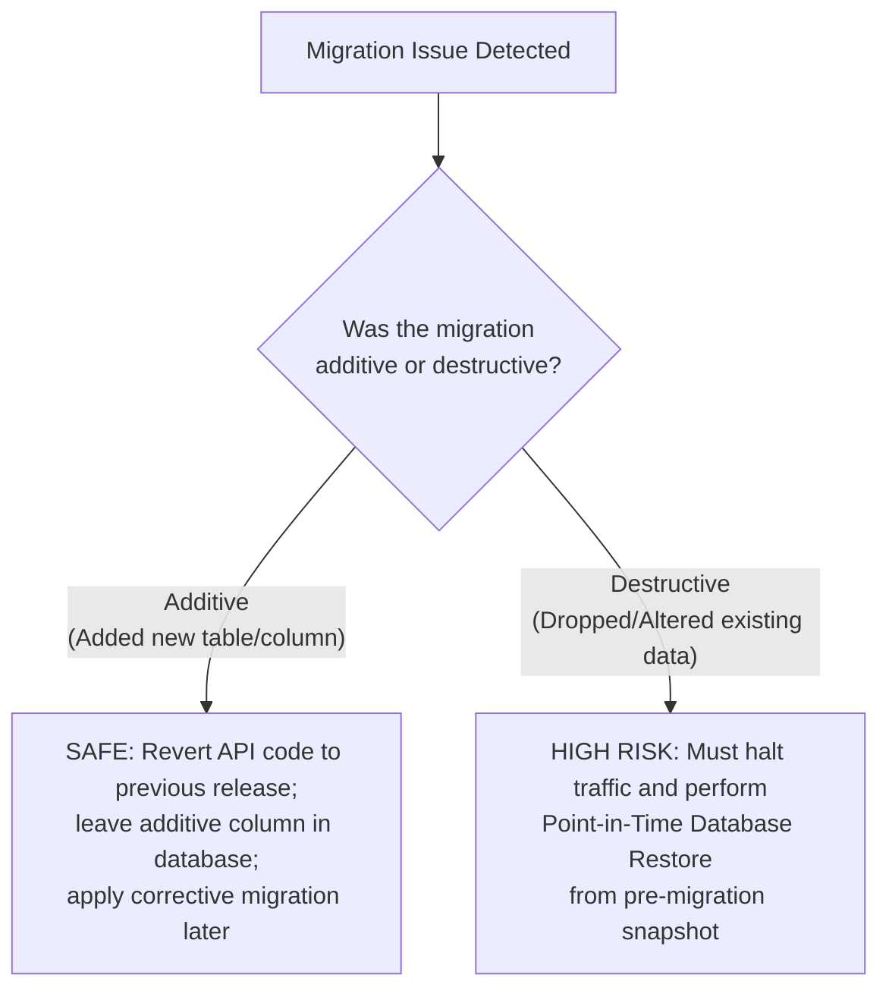

# Comprehensive Rollback Strategy

**Role / Responsibility:** Principal Site Reliability Engineer and Platform / DevOps Lead  
**Last Updated:** November 5, 2026  
**Status:** ACTIVE & APPROVED  
**Scope:** Reversible and Irreversible Rollback Procedures across API, Web, Proxy, Database, and Storage.

---

## 1. Principles & Reversibility Classification

Every component in the Kinergy Platform has an explicit reversibility profile. Operators must consult this classification before executing rollback actions.

| Component / Layer         | Reversibility Profile            | Rollback Mechanism                                     | Expected Duration | Data Loss Risk                                       |
| :------------------------ | :------------------------------- | :----------------------------------------------------- | :---------------- | :--------------------------------------------------- |
| **Web Container (SPA)**   | Fully Reversible                 | Revert container image tag to previous release         | < 1 minute        | **Zero**                                             |
| **API Container**         | Reversible (if schema unchanged) | Revert container image tag to previous release         | < 2 minutes       | **Zero**                                             |
| **Reverse Proxy (Nginx)** | Fully Reversible                 | Revert `nginx.conf` and issue `nginx -s reload`        | < 30 seconds      | **Zero**                                             |
| **Environment Secrets**   | Fully Reversible                 | Restore previous secret version in secret manager      | < 2 minutes       | **Zero**                                             |
| **Storage Configuration** | Fully Reversible                 | Revert bucket policy or CORS settings                  | < 5 minutes       | **Zero**                                             |
| **Additive Migration**    | Forward Fix Preferred            | Revert API; additive schema can remain safely          | < 5 minutes       | **Zero**                                             |
| **Destructive Migration** | **IRREVERSIBLE via Code**        | Requires Point-in-Time Database Restore                | 10 - 30 minutes   | Potential loss of transactions committed post-backup |
| **Secret Rotation**       | Conditional                      | Re-activate previous secret (if within overlap window) | < 5 minutes       | Potential invalidation of newly issued tokens        |

---

## 2. Component Rollback Procedures

### 2.1 API Image Rollback

If the newly deployed API version exhibits fatal errors, memory leaks, or dependency crashes:

1. Identify the previous stable image tag (e.g. `kinergy-api:1.0.0-rc.0` or `kinergy-api:git-prev-sha`).
2. Deploy the previous image:
   ```bash
   # Docker Compose Staging
   API_IMAGE=kinergy-api:git-prev-sha docker compose -f docker-compose.staging.yml up -d --no-deps staging-api

   # Kubernetes Production
   kubectl rollout undo deployment/kinergy-api
   ```
3. Verify readiness probe returns 200 OK:
   ```bash
   curl -f http://localhost:3001/api/v1/health/readiness
   ```

### 2.2 Web SPA Rollback

If frontend client errors (broken JS bundle, styling regression, routing crash) occur:

1. Revert web container image to previous stable tag:
   ```bash
   # Docker Compose Staging
   WEB_IMAGE=kinergy-web:git-prev-sha docker compose -f docker-compose.staging.yml up -d --no-deps staging-web

   # Kubernetes Production
   kubectl rollout undo deployment/kinergy-web
   ```
2. Purge edge CDN cache (Cloudflare / Fastly) for `index.html` and assets.

### 2.3 Reverse Proxy / Ingress Rollback

If proxy routing changes break `/api/*` or static assets:

1. Restore previous `infrastructure/deployment/docker/nginx.conf`.
2. Test configuration syntax:
   ```bash
   docker exec kinergy-staging-web nginx -t
   ```
3. Reload Nginx without dropping active client connections:
   ```bash
   docker exec kinergy-staging-web nginx -s reload
   ```

### 2.4 Environment Secret Rollback

If an invalid secret or corrupted connection string is injected:

1. Roll back the secret version in the secret manager (AWS Secrets Manager / Vault / Cloudflare).
2. Trigger an immediate rolling restart of the API container so it re-reads clean configuration:
   ```bash
   docker restart kinergy-staging-api
   ```

---

## 3. Database Migration Rollback Strategy & Limitations

### Crucial Principle: Prisma Rollbacks

Prisma does not provide automatic down migrations. Attempting to reverse a schema change must follow one of two paths:



### Stop Conditions: When NOT to Roll Back

1. **Never roll back the API image if it expects a contracted schema that has already been dropped.**  
   If Release N+1 dropped an old column (Contract phase) and Release N application code is restored, Release N will immediately crash on missing columns.
2. **Never roll back a database migration by manually deleting rows from `_prisma_migrations` without DBA approval.**  
   Tampering with `_prisma_migrations` creates checksum drift that permanently halts future `prisma migrate deploy` runs.

---

## 4. Secret Rotation Rollback

During secret rotation (e.g. `JWT_ACCESS_SECRET` or `JWT_REFRESH_SECRET`):

1. **Grace Overlap Window:** Production secret rotation must configure dual-key verification where possible (accepting tokens signed with old key for 15 minutes while signing new tokens with new key).
2. **Emergency Rollback:** If a newly rotated secret causes widespread user logouts:
   - Restore previous secret in environment configuration.
   - Restart API pods.
   - Users whose tokens were signed by the temporary new key will be prompted to re-authenticate, but historical sessions remain valid.
