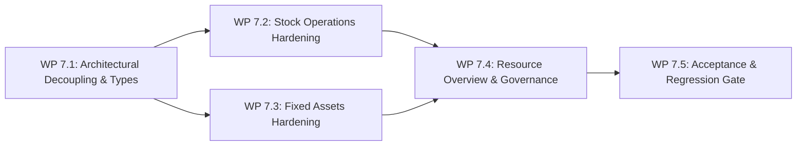
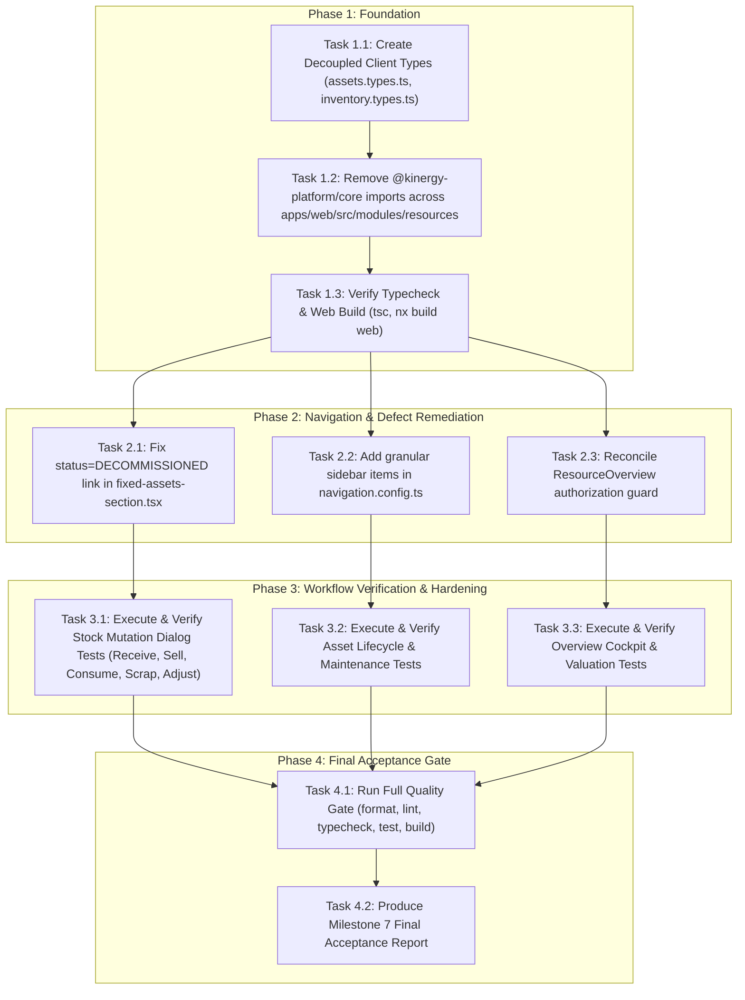

# Milestone 7: Resources and Inventory Implementation Blueprint

**Status:** Approved & Frozen  
**Author:** Senior Technical Lead, Principal Frontend Architect & DDD Systems Engineer  
**Scope:** Milestone 7 — Resources & Inventory Productization Hardening (Consumables, Fixed Assets, Stock Ledger Invariants, Valuation Cockpit, and Architectural Decoupling)  
**Date:** October 2026  
**Audited Baseline:** [`docs/audits/milestone-7-resources-inventory-audit.md`](file:///c:/Projects/kinergy-platform/docs/audits/milestone-7-resources-inventory-audit.md)  
**Authoritative References:**

- [`docs/audits/frontend-productization/frontend-productization-roadmap.md`](file:///c:/Projects/kinergy-platform/docs/audits/frontend-productization/frontend-productization-roadmap.md) (`ROADMAP-FE-007`)
- [`docs/audits/frontend-productization/backend-frontend-coverage-matrix.md`](file:///c:/Projects/kinergy-platform/docs/audits/frontend-productization/backend-frontend-coverage-matrix.md) (`Section 6`)
- [`docs/architecture/resources/adr/0081-resources-bounded-context-topology-and-domain-segregation.md`](file:///c:/Projects/kinergy-platform/docs/architecture/resources/adr/0081-resources-bounded-context-topology-and-domain-segregation.md)
- [`docs/architecture/resources/adr/0082-fixed-asset-domain-modeling-and-complete-segregation-from-inventory.md`](file:///c:/Projects/kinergy-platform/docs/architecture/resources/adr/0082-fixed-asset-domain-modeling-and-complete-segregation-from-inventory.md)
- [`docs/architecture/resources/adr/0083-inventory-movement-ledger-and-materialized-stock-mutation-strategy.md`](file:///c:/Projects/kinergy-platform/docs/architecture/resources/adr/0083-inventory-movement-ledger-and-materialized-stock-mutation-strategy.md)
- [`docs/architecture/resources/adr/0084-inventory-concurrency-control-and-race-condition-prevention.md`](file:///c:/Projects/kinergy-platform/docs/architecture/resources/adr/0084-inventory-concurrency-control-and-race-condition-prevention.md)
- [`docs/architecture/resources/adr/0087-resource-valuation-and-on-demand-asset-depreciation-strategy.md`](file:///c:/Projects/kinergy-platform/docs/architecture/resources/adr/0087-resource-valuation-and-on-demand-asset-depreciation-strategy.md)
- [`docs/architecture/resources/adr/0089-inventory-monetary-quantity-and-unit-precision-semantics.md`](file:///c:/Projects/kinergy-platform/docs/architecture/resources/adr/0089-inventory-monetary-quantity-and-unit-precision-semantics.md)
- [`docs/architecture/resources/adr/0091-resources-persistence-architecture-postgresql-constraints-and-atomic-ledger-isolation.md`](file:///c:/Projects/kinergy-platform/docs/architecture/resources/adr/0091-resources-persistence-architecture-postgresql-constraints-and-atomic-ledger-isolation.md)
- [`docs/architecture/resources/adr/0092-consumable-inventory-application-orchestration-and-atomic-stock-mutation-pattern.md`](file:///c:/Projects/kinergy-platform/docs/architecture/resources/adr/0092-consumable-inventory-application-orchestration-and-atomic-stock-mutation-pattern.md)
- [`docs/architecture/resources/adr/0094-resources-authorization-and-permission-taxonomy-model.md`](file:///c:/Projects/kinergy-platform/docs/architecture/resources/adr/0094-resources-authorization-and-permission-taxonomy-model.md)
- [`docs/architecture/resources/adr/0095-resource-sensitive-valuation-data-access-and-response-shaping-policy.md`](file:///c:/Projects/kinergy-platform/docs/architecture/resources/adr/0095-resource-sensitive-valuation-data-access-and-response-shaping-policy.md)
- [`docs/architecture/resources/adr/0096-consumable-inventory-operational-valuation-basis.md`](file:///c:/Projects/kinergy-platform/docs/architecture/resources/adr/0096-consumable-inventory-operational-valuation-basis.md)
- [`docs/architecture/resources/adr/0097-fixed-asset-carrying-valuation-and-balance-sheet-integration.md`](file:///c:/Projects/kinergy-platform/docs/architecture/resources/adr/0097-fixed-asset-carrying-valuation-and-balance-sheet-integration.md)
- [`docs/architecture/resources/adr/0098-cross-domain-derived-resource-valuation-architecture.md`](file:///c:/Projects/kinergy-platform/docs/architecture/resources/adr/0098-cross-domain-derived-resource-valuation-architecture.md)
- [`docs/architecture/resources/adr/0099-explicit-subresource-state-mutation-endpoints-vs-generic-patch.md`](file:///c:/Projects/kinergy-platform/docs/architecture/resources/adr/0099-explicit-subresource-state-mutation-endpoints-vs-generic-patch.md)
- [`docs/architecture/resources/adr/0100-frontend-resources-feature-module-boundaries.md`](file:///c:/Projects/kinergy-platform/docs/architecture/resources/adr/0100-frontend-resources-feature-module-boundaries.md)
- [`docs/architecture/resources/adr/0104-resources-cross-domain-decoupling-and-client-boundary-invariant.md`](file:///c:/Projects/kinergy-platform/docs/architecture/resources/adr/0104-resources-cross-domain-decoupling-and-client-boundary-invariant.md)
- [`docs/architecture/resources/adr/0106-sales-inventory-integration-boundary-and-stock-ownership-policy.md`](file:///c:/Projects/kinergy-platform/docs/architecture/resources/adr/0106-sales-inventory-integration-boundary-and-stock-ownership-policy.md)

---

## 1. Executive Summary & Architectural Scope

This blueprint defines the **deterministic, dependency-ordered technical specification and implementation plan** for **Milestone 7: Resources & Inventory Productization Hardening**.

Unlike milestones that required net-new backend application wiring (e.g. Milestone 4 Scheduling) or competing module consolidation (e.g. Milestone 6 Gym Management), the Resources & Inventory bounded context features an already complete, end-to-end connected implementation. The mission of Milestone 7 is **hardening, defect remediation, architectural bundle decoupling, authorization alignment, and exhaustive verification**.

### 1.1 Objective & Business Outcomes

When Milestone 7 is delivered, operational staff, warehouse managers, receptionists, and executives will have:

1. **Zero Core Bundle Leakage**: The frontend module `apps/web/src/modules/resources` will be completely decoupled from `@kinergy-platform/core`, resolving bundle bloat and maintaining clean architectural layering.
2. **Deterministic Stock Ledger Operations**: Authoritative double-entry stock transactions (`PURCHASE`, `SALE`, `CONSUMPTION`, `SCRAP`, `ADJUSTMENT`) with non-negative stock guards, optimistic concurrency lock handling, and idempotency protection.
3. **Robust Capital Asset Governance**: Full lifecycle tracking (`ACTIVE`, `UNDER_MAINTENANCE`, `DAMAGED`, `RETIRED`, `SOLD`), physical room transfers, condition ratings (ranks 1–5), servicing work orders with auto-recovery, and dual-permission fair-value revaluation.
4. **Reliable Executive Resource Cockpit**: Consolidated valuation dashboard (`/resources/overview`) combining working capital and capital equipment book values, with reconciled authorization gates and resolved navigation links.

---

## 2. Audit Revalidation & Scope Classification

### 2.1 Revalidation Against Current Repository Baseline

The Milestone 7.1 audit report ([`docs/audits/milestone-7-resources-inventory-audit.md`](file:///c:/Projects/kinergy-platform/docs/audits/milestone-7-resources-inventory-audit.md)) was revalidated against git branch `main` at commit `87a18af`:

- **All 15 frontend screens and dialogs** exist and map to the 16 backend endpoints in `InventoryController`, `FixedAssetsController`, `ResourceOverviewController`, and `ResourceValuationController`.
- **48 core test suites (709 tests)**, **39 web test suites (397 tests)**, and **13 API unit/contract suites (235 tests)** continue to pass with 100% deterministic success.
- **The critical findings remain confirmed**:
  1. `apps/web/src/modules/resources/` contains 40 direct imports from `@kinergy-platform/core`.
  2. `fixed-assets-section.tsx#L239` links to `status=DECOMMISSIONED`, which triggers an HTTP 400 Bad Request on `ListFixedAssetsQueryDto.status`.
  3. `ResourceOverviewController` requires BOTH roles AND permissions, causing an authorization mismatch with `ResourceOverviewPage`.
  4. `navigation.config.ts` lacks dedicated entries for `/resources/inventory` and `/resources/assets`.
  5. Automated straight-line depreciation (ADR-0087) does not exist in schema or aggregate; the system uses a Manual Fair-Value Revaluation model.

### 2.2 Scope Classification Matrix

| Item / Finding                                  | Classification                                     | Rationale & Target Work Package                                                                                                               |
| :---------------------------------------------- | :------------------------------------------------- | :-------------------------------------------------------------------------------------------------------------------------------------------- |
| **Decouple `@kinergy-platform/core` Imports**   | **Required for Architectural Correctness**         | Eliminates server domain barrel leakage into the client bundle; enforces clean monorepo layering (**WP 7.1**).                                |
| **Fix Broken Status Link (`DECOMMISSIONED`)**   | **Required for Acceptance (Defect)**               | Resolves HTTP 400 Bad Request when navigating from overview to retired assets (**WP 7.3**).                                                   |
| **Harden Stock Mutation Workflows**             | **Required for Acceptance**                        | Verifies non-negative stock invariants, OCC conflict feedback, idempotency, and cache invalidation (**WP 7.2**).                              |
| **Harden Fixed Asset Lifecycle & Work Orders**  | **Required for Acceptance**                        | Verifies state machine transitions, terminal status protections, physical transfers, and maintenance logs (**WP 7.3**).                       |
| **Reconcile Overview Authorization Gate**       | **Required to Correct Security Defect**            | Aligns backend `@Roles` / `@Permissions` conjunction with frontend permission evaluation (**WP 7.4**).                                        |
| **Granular Sidebar Navigation Entries**         | **UX Improvement Supporting Required Workflow**    | Allows non-executive users (e.g. Kitchen Staff with `inventory.read`) to access `/resources/inventory` (**WP 7.4**).                          |
| **Preserve Deep-Linking & Dirty Dialog Guards** | **Required to Preserve Existing Workflows**        | Preserves `?action=...` deep-linking and `useDirtyDialogGuard` confirmation flows (**WP 7.2, WP 7.3**).                                       |
| **Automated Depreciation Engine (ADR-0087)**    | **Backend Extension (Requires Explicit Approval)** | Current data model lacks `depreciation_schedule` column. Requires database migration; deferred/formalized as manual revaluation (**WP 7.4**). |
| **Active Event Bus Integration**                | **Out of Scope (Deferred to Milestone 9)**         | Cross-domain event projection infrastructure belongs to Milestone 9 (Cross-Domain Integration & Business Acceptance).                         |
| **Point-of-Sale Retail Checkout UI**            | **Out of Scope**                                   | Belongs to Milestone 8 (Sales & Payments Financial Productization).                                                                           |

---

## 3. Work Packages Specification



---

### Work Package 7.1 — Architecture & Client Type Decoupling

#### 1. Objective

Eliminate all direct imports from `@kinergy-platform/core` in `apps/web/src/modules/resources/`, replacing them with client-safe TypeScript enums, interfaces, and schemas.

#### 2. Affected Files

- Modify: `apps/web/src/modules/resources/assets/types/assets.types.ts`
- Modify: `apps/web/src/modules/resources/assets/schemas/assets.schema.ts`
- Modify: `apps/web/src/modules/resources/inventory/types/inventory.types.ts`
- Modify: `apps/web/src/modules/resources/inventory/schemas/inventory.schema.ts`
- Modify: `apps/web/src/modules/resources/assets/components/asset-status-dialog.tsx`
- Modify: `apps/web/src/modules/resources/assets/components/asset-condition-dialog.tsx`
- Modify: `apps/web/src/modules/resources/assets/components/asset-maintenance-dialog.tsx`
- Modify: `apps/web/src/modules/resources/assets/components/asset-transfer-dialog.tsx`
- Modify: `apps/web/src/modules/resources/assets/components/asset-valuation-dialog.tsx`
- Modify: `apps/web/src/modules/resources/assets/components/asset-create-form.tsx`
- Modify: `apps/web/src/modules/resources/assets/components/asset-edit-form.tsx`
- Modify: `apps/web/src/modules/resources/assets/components/asset-history-item.tsx`
- Modify: `apps/web/src/modules/resources/assets/routes/asset-detail-page.tsx`
- Modify: `apps/web/src/modules/resources/assets/routes/asset-history-page.tsx`
- Modify: `apps/web/src/modules/resources/inventory/components/product-create-form.tsx`
- Modify: `apps/web/src/modules/resources/inventory/components/product-edit-form.tsx`
- Modify: `apps/web/src/modules/resources/inventory/routes/inventory-detail-page.tsx`
- Modify: All associated test files in `apps/web/src/modules/resources/**/__tests__/`

#### 3. Technical Specification

1. **Define Local Client Enums**:
   In `assets.types.ts` and `inventory.types.ts`, declare standalone client enums matching the backend contracts:
   ```typescript
   export enum AssetStatus {
     ACTIVE = 'ACTIVE',
     UNDER_MAINTENANCE = 'UNDER_MAINTENANCE',
     DAMAGED = 'DAMAGED',
     RETIRED = 'RETIRED',
     SOLD = 'SOLD',
   }

   export enum AssetCondition {
     EXCELLENT = 'EXCELLENT',
     GOOD = 'GOOD',
     FAIR = 'FAIR',
     NEEDS_REPAIR = 'NEEDS_REPAIR',
     OUT_OF_SERVICE = 'OUT_OF_SERVICE',
   }

   export enum AssetCategory {
     GYM_EQUIPMENT = 'GYM_EQUIPMENT',
     THERAPY_EQUIPMENT = 'THERAPY_EQUIPMENT',
     KITCHEN_EQUIPMENT = 'KITCHEN_EQUIPMENT',
     OFFICE_FURNITURE = 'OFFICE_FURNITURE',
     ELECTRONICS = 'ELECTRONICS',
     CLEANING_EQUIPMENT = 'CLEANING_EQUIPMENT',
   }

   export enum InventoryCategory {
     CLEANING_SUPPLIES = 'CLEANING_SUPPLIES',
     OFFICE_SUPPLIES = 'OFFICE_SUPPLIES',
     SUPPLEMENTS = 'SUPPLEMENTS',
     CLINICAL_SUPPLIES = 'CLINICAL_SUPPLIES',
     THERAPY_CONSUMABLES = 'THERAPY_CONSUMABLES',
     RETAIL_PRODUCTS = 'RETAIL_PRODUCTS',
   }

   export enum UnitOfMeasure {
     UNITS = 'UNITS',
     BOXES = 'BOXES',
     BOTTLES = 'BOTTLES',
     KILOGRAMS = 'KILOGRAMS',
     LITERS = 'LITERS',
   }

   export enum StockMovementType {
     PURCHASE = 'PURCHASE',
     SALE = 'SALE',
     CONSUMPTION = 'CONSUMPTION',
     SCRAP = 'SCRAP',
     ADJUSTMENT = 'ADJUSTMENT',
   }
   ```
2. **Client-Safe State Machine Rules**:
   Replace the server `AssetLifecycleStateMachine` import in `asset-status-dialog.tsx` with a client-safe transition lookup table:
   ```typescript
   export const CLIENT_ASSET_TRANSITIONS: Record<AssetStatus, readonly AssetStatus[]> = {
     [AssetStatus.ACTIVE]: [
       AssetStatus.UNDER_MAINTENANCE,
       AssetStatus.DAMAGED,
       AssetStatus.RETIRED,
       AssetStatus.SOLD,
     ],
     [AssetStatus.UNDER_MAINTENANCE]: [
       AssetStatus.ACTIVE,
       AssetStatus.DAMAGED,
       AssetStatus.RETIRED,
       AssetStatus.SOLD,
     ],
     [AssetStatus.DAMAGED]: [
       AssetStatus.UNDER_MAINTENANCE,
       AssetStatus.ACTIVE,
       AssetStatus.RETIRED,
       AssetStatus.SOLD,
     ],
     [AssetStatus.RETIRED]: [AssetStatus.SOLD],
     [AssetStatus.SOLD]: [],
   };
   ```
3. **Verification**:
   Execute grep check ensuring zero instances of `from '@kinergy-platform/core'` exist in `apps/web/src/modules/resources/`.

---

### Work Package 7.2 — Consumable Stock Operations Hardening

#### 1. Objective

Verify and harden the 5 operational stock mutation workflows (Receive, Sell, Consume, Scrap, Adjust) and catalog lifecycle operations (Create, Edit, Archive, Activate).

#### 2. Workflow Specifications

##### A. Inbound Stock Receiving (`ReceiveStockDialog`)

- **Business Purpose**: Record vendor delivery of consumable stock.
- **Entry Point**: `ReceiveStockDialog` opened from `InventoryDetailPage` or `LowStockPage`.
- **HTTP Method & Route**: `POST /api/v1/resources/inventory/:id/receive`
- **Request Payload**:
  ```typescript
  interface ReceiveStockRequestDto {
    quantity: number; // > 0, max 2 decimals
    unitCostAmount?: number; // >= 0
    referenceNumber: string; // Vendor invoice / PO number (min 1 char)
    notes?: string;
  }
  ```
- **Response**: `StockMutationResultDto` (`{ item: InventoryProductDto, movement: StockMovementDto }`).
- **Required Permission**: `inventory.write`.
- **Idempotency Strategy**: `referenceNumber` passes to `referenceId` in `StockOperationOrchestrator`. Duplicate submissions return the existing movement without double-incrementing.
- **Cache Invalidation**:
  `inventoryQueryKeys.detail(id)`, `inventoryQueryKeys.stock(id)`, `inventoryQueryKeys.movementsLists(id)`, `inventoryQueryKeys.lists()`, `inventoryQueryKeys.lowStock()`, `inventoryQueryKeys.valuation()`, `resourceOverviewQueryKeys.all`.

##### B. Retail Stock Sale (`SellStockDialog`)

- **Business Purpose**: Decrement stock due to over-the-counter or retail point-of-sale checkout.
- **Entry Point**: `SellStockDialog` on `InventoryDetailPage`.
- **HTTP Method & Route**: `POST /api/v1/resources/inventory/:id/sell`
- **Request Payload**:
  ```typescript
  interface SellStockRequestDto {
    quantity: number; // > 0, max 2 decimals
    unitPriceAmount?: number; // >= 0
    referenceNumber?: string; // Receipt number
    notes?: string;
  }
  ```
- **Invariants Enforced**:
  - `quantity <= currentStock`: Rejects with `InsufficientStockException` (HTTP 400) if quantity exceeds available balance.
  - Active status: Cannot sell archived products.
- **Required Permission**: `inventory.write`.

##### C. Clinical & Gym Consumption (`ConsumeStockDialog`)

- **Business Purpose**: Record supplies utilized during kinesiology treatment sessions or gym sanitation.
- **Entry Point**: `ConsumeStockDialog` on `InventoryDetailPage`.
- **HTTP Method & Route**: `POST /api/v1/resources/inventory/:id/consume`
- **Request Payload**:
  ```typescript
  interface ConsumeStockRequestDto {
    quantity: number; // > 0
    referenceNumber?: string; // Treatment session ID / room ID
    notes?: string;
  }
  ```
- **Invariants Enforced**: `quantity <= currentStock`. Rejects over-consumption with HTTP 400.
- **Required Permission**: `inventory.write`.

##### D. Stock Scrap & Disposal (`ScrapStockDialog`)

- **Business Purpose**: Write off damaged, expired, or spoiled inventory.
- **Entry Point**: `ScrapStockDialog` on `InventoryDetailPage`.
- **HTTP Method & Route**: `POST /api/v1/resources/inventory/:id/scrap`
- **Request Payload**:
  ```typescript
  interface ScrapStockRequestDto {
    quantity: number; // > 0
    reason: string; // Min 3 characters (e.g. "Expired batch", "Broken container")
    notes?: string;
  }
  ```
- **Invariants Enforced**: `quantity <= currentStock`.
- **Required Permission**: `inventory.write`.

##### E. Physical Audit Stock Adjustment (`AdjustStockDialog`)

- **Business Purpose**: Reconcile physical warehouse counts with digital system balances.
- **Entry Point**: `AdjustStockDialog` on `InventoryDetailPage`.
- **HTTP Method & Route**: `POST /api/v1/resources/inventory/:id/adjust`
- **Request Payload**:
  ```typescript
  interface AdjustStockRequestDto {
    quantityDelta: number; // Non-zero signed number (+/-)
    reason: string; // Min 3 characters (audit reconciliation reason)
  }
  ```
- **Invariants Enforced**: If negative delta, `Math.abs(quantityDelta) <= currentStock`. Resulting balance cannot be negative.
- **Required Permission**: `inventory.write`.

#### 3. Error Handling and User Feedback

- **HTTP 400 (Domain Invariant / Validation)**: Display exact server domain message in `FormValidationSummary` and destructive alert.
- **HTTP 409 (Optimistic Concurrency Collision)**: Display conflict notification: _"This inventory item was updated by another user. Refreshing current stock..."_, trigger refetch of `inventoryQueryKeys.detail(id)`, and leave form open for retry.
- **Duplicate Prevention**: Buttons disable during `isPending` with loading spinner.

---

### Work Package 7.3 — Fixed Capital Assets Hardening

#### 1. Objective

Resolve navigation defects, verify lifecycle state machine enforcement, protect terminal asset states, and harden maintenance work order workflows.

#### 2. Defect Remediation: Broken Overview Status Link

- **File**: `apps/web/src/modules/resources/overview/components/fixed-assets-section.tsx#L239`
- **Defect**:
  ```tsx
  // BEFORE (Defective: DECOMMISSIONED causes HTTP 400 Bad Request)
  <Link to="/resources/assets?status=DECOMMISSIONED">
  ```
- **Remediation**:
  Update to use the supported filter query parameter `includeDecommissioned=true`:
  ```tsx
  // AFTER (Supported by ListFixedAssetsQueryDto)
  <Link to="/resources/assets?includeDecommissioned=true">
  ```
  Or to filter explicitly by `RETIRED` status:
  ```tsx
  <Link to={`/resources/assets?status=${AssetStatus.RETIRED}&includeDecommissioned=true`}>
  ```

#### 3. Workflow Specifications

##### A. Asset Location Transfer (`TransferAssetLocationDialog`)

- **Route**: `POST /api/v1/resources/assets/:id/transfer`
- **Payload**: `{ location: { facilityId: string, roomId?: string, zone?: string, description?: string }, reason?: string }`
- **Invariant**: Prohibited if asset status is `RETIRED` or `SOLD` (`[AST-INV-2]`).
- **Permission**: `assets.write`.

##### B. Status Transition (`ChangeAssetStatusDialog`)

- **Route**: `POST /api/v1/resources/assets/:id/status`
- **Payload**: `{ status: AssetStatus, reason: string }`
- **Invariant**: Strictly validates against `AssetLifecycleStateMachine`. `SOLD` is irreversible. Retiring an asset prompts secondary confirmation via `RetireAssetDialog`.
- **Permission**: `assets.write` + roles (`ADMIN`, `SUPER_ADMIN`, `OWNER`).

##### C. Condition Rating Update (`UpdateAssetConditionDialog`)

- **Route**: `POST /api/v1/resources/assets/:id/condition`
- **Payload**: `{ condition: AssetCondition, reason?: string }`
- **Ratings**: `EXCELLENT`, `GOOD`, `FAIR`, `NEEDS_REPAIR`, `OUT_OF_SERVICE`.
- **Permission**: `assets.write`.

##### D. Maintenance Work Order Logging (`RecordAssetMaintenanceDialog`)

- **Route**: `POST /api/v1/resources/assets/:id/maintenance`
- **Payload**: `{ serviceDate: string, description: string, costAmount: number, performedBy: string, notes?: string }`
- **Invariant**: Auto-recovers asset from `UNDER_MAINTENANCE` to `ACTIVE`.
- **Permission**: `assets.write`.

##### E. Fair-Value Revaluation (`UpdateAssetValuationDialog`)

- **Route**: `POST /api/v1/resources/assets/:id/valuation`
- **Payload**: `{ estimatedValueAmount: number, reason?: string }`
- **Invariant**: Dual permission protected. Updates balance sheet carrying value.
- **Permission**: `assets.write` + `billing.read`.

---

### Work Package 7.4 — Executive Resource Overview & Financial Governance

#### 1. Objective

Reconcile overview authorization, align sidebar navigation, and formalize valuation calculations.

#### 2. Authorization Alignment Options

There are two architectural paths to resolve the conjunction mismatch between `ResourceOverviewController` and `ResourceOverviewPage`:

##### Recommended Path: Backend Conjunction Normalization

Modify `ResourceOverviewController` (`apps/api/src/resources/controllers/resource-overview.controller.ts#L37-38`) to allow executive roles OR composed permissions:

```typescript
// Replace restrictive conjunction with custom evaluator or separate role check
@Roles('ADMIN', 'SUPER_ADMIN', 'OWNER')
@Permissions('inventory.read', 'assets.read', 'billing.read')
```

If modified to evaluate as an `OR` policy:

- Users with role `ADMIN`, `SUPER_ADMIN`, or `OWNER` can access the dashboard.
- Users with granular permissions `inventory.read` + `assets.read` + `billing.read` (e.g. Financial Controllers) can access the dashboard.

##### Alternative Path: Frontend Alignment

If backend decorators cannot be modified without an explicit ADR amendment:
Update `ResourceOverviewPage#L28-38` to enforce the backend's strict conjunction:

```typescript
const isAuthorized = React.useMemo(() => {
  if (!currentUser) return false;
  const hasRole = hasRole('ADMIN') || hasRole('SUPER_ADMIN') || hasRole('OWNER');
  const hasPerms =
    hasPermission('inventory.read') &&
    hasPermission('assets.read') &&
    hasPermission('billing.read');
  return hasRole && hasPerms;
}, [currentUser, hasRole, hasPermission]);
```

#### 3. Sidebar Navigation Enhancement

Update `apps/web/src/app/navigation/navigation.config.ts#L95-102` to register accessible entries for all operational personas:

```typescript
{
  id: 'resources-overview',
  label: 'Resource Overview',
  path: '/resources/overview',
  icon: LayoutDashboard,
  order: 34,
  section: 'core',
  requiredPermissions: ['inventory.read', 'assets.read', 'billing.read'],
},
{
  id: 'inventory-catalog',
  label: 'Consumable Inventory',
  path: '/resources/inventory',
  icon: Boxes,
  order: 35,
  section: 'core',
  requiredPermissions: ['inventory.read'],
},
{
  id: 'assets-catalog',
  label: 'Fixed Assets',
  path: '/resources/assets',
  icon: Landmark,
  order: 36,
  section: 'core',
  requiredPermissions: ['assets.read'],
},
```

#### 4. Valuation Documentation Formalization

- Supercede or document an amendment to **ADR-0087**: Formally state that Kinergy operates on an on-demand **Manual Fair-Value Revaluation model** rather than background cron-based straight-line depreciation.
- Ensure `OverallResourceValueCard` displays the delta between purchase cost and carrying value as a descriptive financial variance rather than automated tax depreciation.

---

## 4. Acceptance Test Matrix

Before declaring Milestone 7 complete, the following test matrix must pass:

| Area                  | Test Identifier | Scenario & Given Conditions                                         | Expected Outcome                                                                                   |
| :-------------------- | :-------------- | :------------------------------------------------------------------ | :------------------------------------------------------------------------------------------------- |
| **Stock Operations**  | `TEST-STK-01`   | Receive 50 units of product with reference `"PO-9912"`              | Stock increases by 50; `PURCHASE` movement recorded; valuation updates; query cache invalidated.   |
| **Stock Operations**  | `TEST-STK-02`   | Receive stock with duplicate reference `"PO-9912"`                  | Idempotency triggered; returns existing movement; no double increment occurs.                      |
| **Stock Operations**  | `TEST-STK-03`   | Sell 10 units when available stock is 5                             | Rejected with `InsufficientStockException` (HTTP 400); balance remains 5; 0 movements logged.      |
| **Stock Operations**  | `TEST-STK-04`   | Sell 5 units from item with stock 5                                 | Balance becomes 0; `isOutOfStock` becomes true; `SALE` movement logged.                            |
| **Stock Operations**  | `TEST-STK-05`   | Scrap 3 units with reason `"Expired batch"`                         | Balance decrements by 3; `SCRAP` movement logged with required reason.                             |
| **Stock Operations**  | `TEST-STK-06`   | Adjust stock with delta `-2` on item with stock 10                  | Balance becomes 8; `ADJUSTMENT` movement logged; before/after balances match.                      |
| **Stock Operations**  | `TEST-STK-07`   | Adjust stock with delta `-15` on item with stock 10                 | Rejected with HTTP 400; negative stock prevented.                                                  |
| **Stock Operations**  | `TEST-STK-08`   | Two concurrent mutations submit with the same version               | One succeeds; second encounters OCC conflict (`OptimisticLockException`); UI prompts refresh.      |
| **Fixed Assets**      | `TEST-AST-01`   | Commission new asset with tag `"TM-101"`                            | HTTP 201; asset created with status `ACTIVE`, condition `EXCELLENT`; `CREATED` event in history.   |
| **Fixed Assets**      | `TEST-AST-02`   | Commission asset with duplicate tag `"TM-101"`                      | Rejected with HTTP 400 / Conflict; tag uniqueness preserved.                                       |
| **Fixed Assets**      | `TEST-AST-03`   | Transition asset from `ACTIVE` to `UNDER_MAINTENANCE`               | Allowed; status updates; offline indicator rendered; history event recorded.                       |
| **Fixed Assets**      | `TEST-AST-04`   | Transition asset from `RETIRED` to `ACTIVE`                         | Rejected with `InvalidAssetStateException`; state machine violation prevented.                     |
| **Fixed Assets**      | `TEST-AST-05`   | Transition asset to `SOLD` and attempt subsequent transfer          | `SOLD` is terminal; subsequent transfer is rejected with domain error.                             |
| **Fixed Assets**      | `TEST-AST-06`   | Record maintenance on asset in `UNDER_MAINTENANCE`                  | Maintenance record created with cost and technician; asset status auto-recovers to `ACTIVE`.       |
| **Fixed Assets**      | `TEST-AST-07`   | Update asset condition to `NEEDS_REPAIR`                            | Condition rank updates to 4; attention queue flags item.                                           |
| **Fixed Assets**      | `TEST-AST-08`   | Update asset fair value without `billing.read` permission           | Action prohibited in UI; direct HTTP request rejected with HTTP 403 Forbidden.                     |
| **Fixed Assets**      | `TEST-AST-09`   | Click "View archives" on overview card                              | Navigates to `/resources/assets?includeDecommissioned=true`; loads successfully without HTTP 400.  |
| **Resource Overview** | `TEST-OVR-01`   | Load overview with active items and assets                          | Returns combined valuation, working capital, and carrying value matching exact integer cents sum.  |
| **Resource Overview** | `TEST-OVR-02`   | Load overview with zero items registered                            | Renders accessible empty estate card (`data-testid="resource-overview-empty"`).                    |
| **Resource Overview** | `TEST-OVR-03`   | User lacking required composed permissions                          | Renders access denied security gate (`data-testid="resource-overview-forbidden"`).                 |
| **Architecture**      | `TEST-ARC-01`   | Scan `apps/web/src/modules/resources/` for `@kinergy-platform/core` | Zero occurrences found; client bundle decoupled; `pnpm build web` succeeds with zero bundle bloat. |

---

## 5. Dependency Graph and Implementation Sequence



### Execution Steps

1. **Step 1: Client Type Decoupling**:
   - Extract `AssetStatus`, `AssetCondition`, `AssetCategory`, `InventoryCategory`, `UnitOfMeasure`, and `StockMovementType` into `assets.types.ts` and `inventory.types.ts`.
   - Update all components, hooks, schemas, and test specs to import locally.
   - Run `npx tsc --noEmit -p tsconfig.base.json` and `npx nx build web` to ensure zero compilation or bundle errors.
2. **Step 2: Navigation & Link Fixes**:
   - Fix `fixed-assets-section.tsx#L239` to link to `?includeDecommissioned=true`.
   - Update `navigation.config.ts` to include standalone links for `/resources/inventory` and `/resources/assets`.
   - Reconcile `ResourceOverviewController` authorization gate.
3. **Step 3: Test Verification Pass**:
   - Run `nx test web --testPathPattern=resources` (39 suites).
   - Run `nx test core --testPathPattern=resources` (48 suites).
   - Run `nx test api --testPathPattern=resources` (13 suites).
4. **Step 4: Quality Gate & Acceptance**:
   - Execute `pnpm validate` (`format:check`, `lint`, `typecheck`, `test`, `build`).
   - Generate Milestone 7 final acceptance report.

---

## 6. Definition of Done (DoD)

Milestone 7 will be declared complete when all of the following criteria are met:

1. **Zero Core Bundle Leaks**: Zero imports from `@kinergy-platform/core` remain in `apps/web/src/modules/resources/`.
2. **Zero Route Defects**: All links and filter combinations on the Resource Overview, Inventory, and Asset catalog screens navigate without HTTP 400 or blank pages.
3. **Authoritative Ledger Intact**: Every positive and negative stock mutation logs an immutable record with correct deltas, before/after balances, reasons, and user identities.
4. **Negative Stock Prevented**: Over-consumption and over-sale attempts are rejected by the backend domain aggregate and reflected clearly in the UI.
5. **Asset State Machine Protected**: All transitions strictly conform to `AssetLifecycleStateMachine`, with `SOLD` enforced as terminal and maintenance auto-recovering to `ACTIVE`.
6. **Authorization Reconciled**: Non-executive users have proper sidebar visibility to their permitted tools, and overview access policies are consistent between client and server.
7. **Quality Gates Green**: `pnpm validate` executes format, lint, typecheck, unit tests, and production build with 100% success.
8. **Documentation Frozen**: Implementation blueprint and acceptance reports committed to repository documentation.
