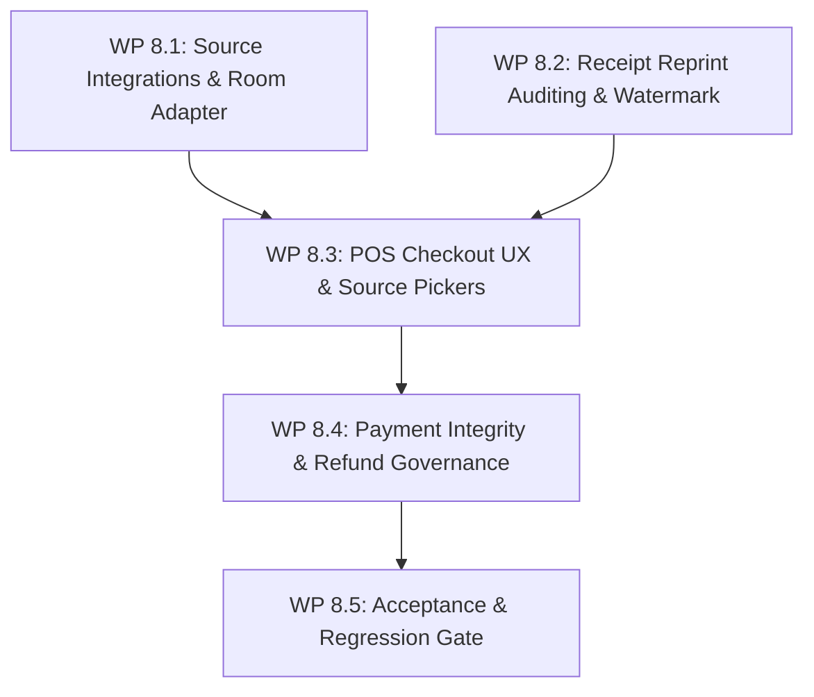
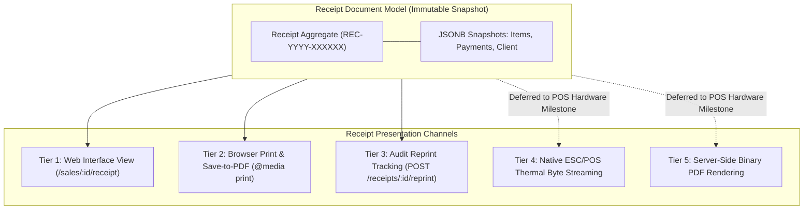

# Milestone 8: Sales, Payments & POS Checkout Implementation Blueprint

**Status:** Approved & Frozen  
**Author:** Senior Technical Lead, Principal Full-Stack Architect & Financial Systems Quality Engineer  
**Scope:** Milestone 8 — Commercial Sourcing Hardening, POS Checkout Experience, Payment Integrity & Settlement, Receipt Reprint Auditing, and Financial Invariant Verification  
**Date:** October 2026  
**Audited Baseline:** [`docs/audits/milestone-7-sales-payments-audit.md`](file:///c:/Projects/kinergy-platform/docs/audits/milestone-7-sales-payments-audit.md)  
**Governing ADRs:**

- [ADR-0108: Deterministic Financial Representation and Currency Modeling](../adr/0108-money-representation.md)
- [ADR-0109: Payment Lifecycle Specification](../adr/0109-payment-lifecycle.md)
- [ADR-0110: Cross-Domain Commercial Sourcing and Entity Decoupling](../adr/0110-cross-domain-commercial-sourcing.md)
- [ADR-0111: Sales & Payments Authorization and Tenant Isolation](../adr/0111-sales-payments-authorization-and-audit.md)
- [ADR-0112: Sales Bounded Context & Unified Commercial Aggregate](../adr/0112-sales-bounded-context.md)
- [ADR-0114: Canonical Monetary Policy and Sale Totals](../adr/0114-canonical-monetary-policy-and-sale-totals.md)
- [ADR-0115: Payment Domain Canonical Architecture](../adr/0115-payment-domain-canonical-architecture.md)
- [ADR-0116: Payment State Machine and Lifecycle Specification](../adr/0116-payment-state-machine-and-lifecycle-specification.md)
- [ADR-0117: Receipt Domain Boundary and Document Snapshot Model](../adr/0117-receipt-domain-boundary-and-document-model.md)
- [ADR-0118: Sale Reference and Receipt Identification Strategy](../adr/0118-sale-reference-and-receipt-identification-strategy.md)
- [ADR-0119: Terminal Settled Sale Immutability and Refund Governance](../adr/0119-terminal-settled-sale-immutability.md)
- [ADR-0121: Cross-Domain Source Validation Adapters](../adr/0121-cross-domain-source-validation-adapters.md)
- [ADR-0133: Payment Application Layer Architecture](../adr/0133-payment-application-layer-architecture.md)
- [ADR-0134: Financial Settlement Validation and Overpayment Invariants](../adr/0134-financial-settlement-validation-and-overpayment-invariants.md)
- [ADR-0135: Sales, Payments & Receipts Authorization Architecture](../adr/0135-sales-payments-receipts-authorization-and-security.md)
- [ADR-0136: Sales API Architecture and REST Contracts](../adr/0136-sales-api-architecture-and-contracts.md)
- [ADR-0138: Payment API Architecture and REST Contracts](../adr/0138-payment-api-architecture-and-contracts.md)
- [ADR-0139: Cross-Domain Commercial Integration & Inventory Boundary](../architecture/resources/adr/0106-sales-inventory-integration-boundary-and-stock-ownership-policy.md)

---

## 1. Executive Summary & Architectural Scope

This blueprint defines the **deterministic, dependency-ordered technical specification and implementation plan** for **Milestone 8: Sales, Payments & POS Checkout Hardening**.

Milestone 8 builds directly upon the certified Phase 7 / Milestone 7.24 financial foundation (`4,362 automated tests passing with 100% success rate`). Rather than redesigning the POS or fragmenting commercial entities into source-specific tables, Milestone 8 hardens and completes verified functional gaps identified during the comprehensive audit:

1. **Scheduling Room Rental Source Integration**: Eliminating the hardcoded \$50.00 fallback stub in `CompositeSaleSourceValidatorAdapter` by connecting a live query port into the Scheduling and Room Management bounded context.
2. **Official Receipt Reprint Auditing**: Connecting the existing domain/application reprint tracking (`ReprintReceiptHandler`, `reprintCount`, `lastReprintedAt`) to a first-class HTTP route (`POST /api/v1/receipts/:id/reprint`) and frontend print workflow.
3. **Point-of-Sale (POS) Checkout UX & Source Selection**: Enriching `SaleCreatePage` with active source selection pickers (clinical sessions, membership plans, retail products) and adding cash drawer tendered/change helper calculations to `RecordPaymentDialog`.
4. **Settled Transaction Reversal Architecture**: Formalizing the compensating refund boundary through a dedicated ADR and application command to safely govern post-settlement commercial adjustments without violating immutable ledger history.
5. **Phase 7.24 Regression Protection**: Ensuring all 28 business acceptance requirements, financial constraints, and E2E scenarios remain 100% verified throughout execution.

---

## 2. Audit Revalidation & Scope Classification

### 2.1 Revalidation Against Current Repository State

The findings documented in [`docs/audits/milestone-7-sales-payments-audit.md`](file:///c:/Projects/kinergy-platform/docs/audits/milestone-7-sales-payments-audit.md) were revalidated against git branch `main` at commit `9c66acf`:

| Area                       | Verified Finding                                                                                                                         | Repository Evidence                                                                                                                                                                         |        Status        |
| :------------------------- | :--------------------------------------------------------------------------------------------------------------------------------------- | :------------------------------------------------------------------------------------------------------------------------------------------------------------------------------------------ | :------------------: |
| **Monetary Arithmetic**    | All arithmetic executes strictly in integer cents with Commercial Half-Up rounding and an IEEE-754 epsilon guard (`+ 1e-8`).             | [`Money.vo.ts#L290-295`](file:///c:/Projects/kinergy-platform/packages/core/src/sales/domain/value-objects/money.vo.ts#L290-L295)                                                           |     **VERIFIED**     |
| **Relational Invariants**  | PostgreSQL `CHECK` constraints prevent negative subtotals, totals, discounts, and zero/negative quantities.                              | `prisma/schema.prisma` (`chk_sales_non_negative_total`)                                                                                                                                     |     **VERIFIED**     |
| **Price Snapshots**        | Line item prices, SKUs, and descriptions are frozen upon addition to `SaleItem`; upstream price edits have zero effect.                  | [`sale-item-historical-snapshot.spec.ts`](file:///c:/Projects/kinergy-platform/packages/core/src/sales/domain/__tests__/sale-item-historical-snapshot.spec.ts)                              |     **VERIFIED**     |
| **Dual-Path Payments**     | `CASH` tenders settle immediately to `COMPLETED`; `QR` tenders initialize in `PENDING` and settle atomically via `/complete`.            | [`create-payment.handler.ts#L210-252`](file:///c:/Projects/kinergy-platform/packages/core/src/sales/application/handlers/create-payment.handler.ts#L210-L252)                               |     **VERIFIED**     |
| **Overpayment Protection** | Payment tenders exceeding remaining sale balance are rejected pre-flight and in database transactions with HTTP 422.                     | [`create-payment.handler.ts#L199-206`](file:///c:/Projects/kinergy-platform/packages/core/src/sales/application/handlers/create-payment.handler.ts#L199-L206)                               |     **VERIFIED**     |
| **Single-Billing Guard**   | Duplicate active sales for clinical treatment sessions are blocked by partial unique index `uq_sales_clinical_session_active`.           | [`sale-commercial-transaction-uniqueness.spec.ts`](file:///c:/Projects/kinergy-platform/packages/core/src/sales/application/__tests__/sale-commercial-transaction-uniqueness.spec.ts)       |     **VERIFIED**     |
| **Soft Cancellation**      | Settled sales (`PAID`, `COMPLETED`) reject cancellation with HTTP 422; open sales cancel softly preserving all rows and items.           | [`sale.aggregate.ts#L1165-1175`](file:///c:/Projects/kinergy-platform/packages/core/src/sales/domain/sale.aggregate.ts#L1165-L1175)                                                         |     **VERIFIED**     |
| **Receipt Immutability**   | Receipts are derived only from settled sales (`PAID`, `COMPLETED`) and capture frozen JSONB snapshots.                                   | [`receipt.aggregate.ts#L115-180`](file:///c:/Projects/kinergy-platform/packages/core/src/sales/domain/receipt.aggregate.ts#L115-L180)                                                       |     **VERIFIED**     |
| **Room Rental Stub Gap**   | `CompositeSaleSourceValidatorAdapter` hardcodes \$50.00 (`unitPriceCents: 5000`) without querying Scheduling or Room tables.             | [`composite-sale-source-validator.adapter.ts#L94-115`](file:///c:/Projects/kinergy-platform/apps/api/src/sales/infrastructure/adapters/composite-sale-source-validator.adapter.ts#L94-L115) | **DEFECT CONFIRMED** |
| **Reprint Route Gap**      | `ReprintReceiptHandler` exists in Core, but `ReceiptsController` exposes no HTTP reprint endpoint; print triggers `window.print()` only. | [`receipts.controller.ts#L80-372`](file:///c:/Projects/kinergy-platform/apps/api/src/sales/controllers/receipts.controller.ts#L80-L372)                                                     |  **GAP CONFIRMED**   |
| **Missing Refund Route**   | `Sale.markRefunded()` and `SaleRefundedEvent` exist in Domain, but no application command, controller route, or UI exists.               | [`sale.aggregate.ts#L1114-1145`](file:///c:/Projects/kinergy-platform/packages/core/src/sales/domain/sale.aggregate.ts#L1114-L1145)                                                         |  **GAP CONFIRMED**   |
| **PDF & ESC/POS Status**   | Milestone 7.17 document is titled "Proposed / Future Milestone Specification"; no binary streaming endpoints exist in API.               | [`milestone-7.17-receipt-pdf-and-thermal-rendering.md`](file:///c:/Projects/kinergy-platform/docs/architecture/milestone-7.17-receipt-pdf-and-thermal-rendering.md#L3)                      | **VERIFIED AS SPEC** |

### 2.2 Scope Classification Matrix

| Item / Finding                               | Classification                            | Rationale & Target Work Package                                                                                                       |
| :------------------------------------------- | :---------------------------------------- | :------------------------------------------------------------------------------------------------------------------------------------ |
| **Live Scheduling Room Source Adapter**      | **Source Integration Gap**                | Replaces synthetic \$50.00 stub with authoritative Room entity lookup and fee schedule (**WP 8.1**).                                  |
| **Expose Receipt Reprint Endpoint**          | **Receipt Capability Gap**                | Connects existing `ReprintReceiptHandler` to `ReceiptsController` and updates `reprintCount` (**WP 8.2**).                            |
| **Reprint Watermark in Frontend Receipt**    | **Receipt Capability Gap**                | Displays `DUPLICATE / REPRINT #N` banner when `reprintCount > 0` in `ReceiptViewPage` (**WP 8.2**).                                   |
| **Checkout Source Selection Pickers**        | **Checkout UX Gap**                       | Replaces raw UUID string inputs in `SaleCreatePage` with modal pickers for clinical/gym/product items (**WP 8.3**).                   |
| **Cash Drawer Calculator (Tender/Change)**   | **Checkout UX Gap**                       | Adds client-side `Amount Tendered` and `Change Due` display without altering backend net tender contract (**WP 8.3**).                |
| **Compensating Refund Application Workflow** | **Backend Extension (Explicit Approval)** | Defines `RefundSaleCommand` and route to transition `PAID` $\to$ `REFUNDED` with audit trail (**WP 8.4**).                            |
| **Multi-Source E2E Regression Verification** | **Required for Acceptance**               | Proves clinical, gym, consumable, and room checkout journeys pass in sequence (**WP 8.5**).                                           |
| **Native Thermal ESC/POS Byte Streaming**    | **Out of Scope (Hardware POS Milestone)** | Hardware-specific printer protocols (58mm/80mm USB/raw socket) belong to dedicated POS Hardware integration milestone.                |
| **Server-Side PDF Generation Engine**        | **Out of Scope (Hardware POS Milestone)** | Browser-driven `@media print` with PDF print-to-file fulfills all legal receipt document requirements without Puppeteer dependencies. |

---

## 3. Work Packages Specification



---

### Work Package 8.1 — Source Integrations & Live Room Adapter

#### 1. Objective

Replace the synthetic room rental fallback in `CompositeSaleSourceValidatorAdapter` with a live, dedicated `SchedulingRoomSourceValidatorAdapter`. Validate room existence, facility operational availability (rejecting rooms in maintenance), and authoritative commercial fee resolution.

#### 2. Technical Architecture & Component Interaction

1. Define outbound port [`ISchedulingRoomLookupPort`](packages/core/src/sales/application/ports/scheduling-room-lookup.port.ts) in the Sales application layer:
   ```typescript
   export interface RoomCommercialReference {
     readonly id: string;
     readonly name: string;
     readonly roomNumber?: string;
     readonly isAvailableForRental: boolean;
     readonly hourlyRateCents: number;
     readonly currency: string;
     readonly status: string;
   }

   export interface ISchedulingRoomLookupPort {
     getRoomReference(roomId: string, tenantId?: string): Promise<RoomCommercialReference | null>;
   }
   ```
2. Implement [`SchedulingRoomSourceValidatorAdapter`](apps/api/src/sales/infrastructure/adapters/scheduling-room-source-validator.adapter.ts):
   - Injects `ISchedulingRoomLookupPort` (or directly calls `GetRoomByIdHandler` from Scheduling).
   - Invariant: Room status must be `ACTIVE`. If status is `MAINTENANCE` or `OUT_OF_SERVICE`, validation fails with HTTP 422 (`Room is currently under maintenance and cannot be rented`).
   - Price Resolution: Resolves `hourlyRateCents` (defaulting to room catalog rate, e.g. \$60.00/hour) multiplied by requested rental duration.
3. Wire into `CompositeSaleSourceValidatorAdapter`:
   - Replace lines 94–115 to delegate `rawType === SaleSourceType.ROOM_RENTAL` to `schedulingRoomAdapter.validate(input)`.

#### 3. Affected Files

- `packages/core/src/sales/application/ports/scheduling-room-lookup.port.ts` (New Port)
- `apps/api/src/sales/infrastructure/adapters/scheduling-room-source-validator.adapter.ts` (New Adapter)
- `apps/api/src/sales/infrastructure/adapters/composite-sale-source-validator.adapter.ts` (Modified)
- `apps/api/src/sales/sales.module.ts` (Provider Wiring)
- `apps/api/src/sales/infrastructure/adapters/__tests__/source-validators.spec.ts` (Unit Tests)

#### 4. Acceptance Criteria

- [ ] Attempting to checkout a nonexistent room ID returns `isValid: false`, `exists: false`.
- [ ] Attempting to checkout a room currently under maintenance returns `isValid: false` with descriptive error message.
- [ ] Authoritative room name and hourly rate are frozen into the `SaleItem` snapshot.
- [ ] Multiple independent sales can legitimately reference the same room for distinct time intervals.

---

### Work Package 8.2 — Receipt Reprint Auditing & Visual Watermarking

#### 1. Objective

Expose the existing `ReprintReceiptHandler` through a dedicated NestJS endpoint and integrate it into the frontend receipt printing workflow to ensure duplicate proof-of-purchase vouchers increment `reprintCount` and carry an unambiguous audit watermark.

#### 2. Technical Architecture & Endpoint Specification

1. **Controller Route**:
   ```typescript
   @Post('receipts/:receiptId/reprint')
   @HttpCode(HttpStatus.OK)
   @Roles('Owner', 'Manager', 'Receptionist', 'Platform Admin')
   @Permissions('receipts.manage')
   @ApiOperation({ summary: 'Record official duplicate reprint of customer receipt voucher' })
   public async reprintReceipt(
     @Param('receiptId') receiptId: string,
     @CurrentUser() user?: AuthenticatedUserPayload,
   ): Promise<ReceiptResponseDto>
   ```
   - Alias route: `@Post('sales/:saleId/receipt/reprint')`.
2. **Application Handler Execution**:
   - Calls `ReprintReceiptHandler.execute(new ReprintReceiptCommand({ receiptId, currentUser, tenantId }))`.
   - Domain aggregate transitions: `receipt.recordReprint(clock)` advances `reprintCount++`, updates `lastReprintedAt = now()`, and publishes `ReceiptReprintedEvent`.
   - Optimistic concurrency control (`version++`) prevents race conditions during duplicate prints.
3. **Frontend API & Hook Integration**:
   - Add `reprintReceipt(receiptId: string)` in `salesApi` (`apps/web/src/modules/sales/api/sales-api.ts`).
   - Add `useReprintReceipt()` mutation hook in `use-sales-mutations.ts`.
4. **Visual Watermark in `ReceiptViewPage`**:
   - In `ReceiptViewPage.tsx`, inspect `receipt.reprintCount`.
   - If `reprintCount > 0`, display a visual header badge and print watermark:
     ```tsx
     <div className="border border-amber-500/40 bg-amber-500/10 text-amber-700 dark:text-amber-300 font-mono text-xs px-3 py-1.5 rounded uppercase font-bold text-center tracking-wider">
       COPY / DUPLICATE VOUCHER — REPRINT #{receipt.reprintCount} (Last:{' '}
       {new Date(receipt.lastReprintedAt!).toLocaleString()})
     </div>
     ```
   - On clicking "Print Receipt", trigger `useReprintReceipt.mutateAsync()` prior to invoking `window.print()`.

#### 3. Affected Files

- `apps/api/src/sales/controllers/receipts.controller.ts` (Expose Route)
- `apps/web/src/modules/sales/api/sales-api.ts` (Add API method)
- `apps/web/src/modules/sales/hooks/use-sales-mutations.ts` (Add Hook)
- `apps/web/src/modules/sales/pages/receipt-view-page.tsx` (Watermark UI & Action)
- `apps/api/src/sales/__tests__/receipts-api.spec.ts` (Endpoint Unit Test)
- `apps/web/src/modules/sales/__tests__/payment-history-and-receipt-view.spec.tsx` (RTL Test)

#### 4. Acceptance Criteria

- [ ] Direct invocation of `POST /api/v1/receipts/:id/reprint` increments `reprintCount` from $0 \to 1$ and sets `lastReprintedAt`.
- [ ] Users lacking `receipts.manage` receive HTTP 403 Forbidden.
- [ ] `ReceiptViewPage` renders the `COPY / DUPLICATE VOUCHER` banner when `reprintCount > 0`.
- [ ] Pure GET queries to `/receipts/:id` remain strictly read-only and never increment `reprintCount`.

---

### Work Package 8.3 — POS Checkout UX & Cash Drawer Calculator

#### 1. Objective

Enhance the point-of-sale checkout workflow in `SaleCreatePage` and `RecordPaymentDialog` to eliminate manual UUID typing, prevent cashier mental math errors during cash tenders, and harden submission idempotency.

#### 2. Detailed Technical Plan

1. **Interactive Source Pickers (`SaleCreatePage`)**:
   - Provide modal selection sheets for origin sources:
     - **Clinical Sessions Picker**: Queries completed unbilled treatment sessions (`/api/v1/kinesiology/treatment-sessions?status=COMPLETED&unbilledOnly=true`).
     - **Membership Plans Picker**: Queries active plans (`/api/v1/gym/membership-plans?status=ACTIVE`).
     - **Consumables Catalog Picker**: Queries active stock inventory items (`/api/v1/resources/inventory?status=ACTIVE`).
   - Selecting an entity automatically populates `clientId`, `unitPrice`, `skuOrCode`, and `description` with authoritative upstream catalog values.
2. **Cash Drawer Calculator (`RecordPaymentDialog`)**:
   - In `RecordPaymentDialog.tsx`, when payment method is `CASH`:
     - Render an optional **"Cash Presented / Tendered"** input field (`data-testid="cash-tendered-input"`).
     - Calculate and display **"Change to Return"**:
       $$\text{changeDue} = \max(0, \text{cashPresented} - \text{paymentAmount})$$
     - If $\text{cashPresented} < \text{paymentAmount}$, display a gentle warning: `Cash tendered is less than the applied payment amount`.
   - **Contract Invariant**: The payload sent to `POST /api/v1/sales/:saleId/payments` remains strictly `{ method: 'CASH', amount: paymentAmount, reference }`. The calculator operates purely on the client side, maintaining backend contract purity.
3. **Idempotency Protection & Button Disabling**:
   - Ensure all submission buttons disable and display loading spinners during active mutations to prevent double-tap submissions.
   - Retain client-generated idempotency keys (`sale_init_<timestamp>_<rand>`) across form re-validations.

#### 3. Affected Files

- `apps/web/src/modules/sales/pages/sale-create-page.tsx` (Interactive Pickers)
- `apps/web/src/modules/sales/components/record-payment-dialog.tsx` (Cash Drawer Calculator)
- `apps/web/src/modules/sales/components/source-selector-dialog.tsx` (New Component)
- `apps/web/src/modules/sales/__tests__/sale-create-workflow.spec.tsx` (RTL Test)
- `apps/web/src/modules/sales/__tests__/financial-form-safety.spec.tsx` (RTL Test)

#### 4. Acceptance Criteria

- [ ] Selecting a clinical session automatically populates client ID, session description, and fee rate.
- [ ] Entering \$100.00 cash tendered against an \$85.00 payment displays "\$15.00 Change Due" cleanly.
- [ ] Submitting the cash payment sends exactly \$85.00 to the backend; overpayment error is prevented.
- [ ] Mutation buttons disable while requests are inflight to block duplicate submissions.

---

### Work Package 8.4 — Payment Integrity, Concurrency & Refund Governance

#### 1. Objective

Protect financial settlement against race conditions, duplicate tenders, and network timeouts. Author an explicit ADR governing compensating refunds for settled transactions.

#### 2. Technical Architecture & Governance Plan

1. **Author ADR-0140: Commercial Refund Architecture & Compensating Transactions**:
   - Define business rules: settled sales (`PAID` or `COMPLETED`) cannot be cancelled via `POST /sales/:id/cancel` (reaffirming ADR-0119).
   - Specify the compensating transition: `Sale.markRefunded(reason, clock)` transitions `status = 'REFUNDED'`, records `refundedAt`, and publishes `SaleRefundedEvent`.
   - Specify the API contract:
     ```
     POST /api/v1/sales/:saleId/refund
     Request: { reason: string, refundMethod: 'CASH' | 'ORIGINAL_TENDER' }
     Auth: Requires 'sales.manage' (Owner / Manager only)
     ```
2. **Application Handler Implementation**:
   - Implement [`RefundSaleHandler`](packages/core/src/sales/application/handlers/refund-sale.handler.ts) and [`RefundSaleCommand`](packages/core/src/sales/application/commands/refund-sale.command.ts).
   - Invariant: Only `PAID` or `COMPLETED` sales can be refunded. Open or cancelled sales throw `InvalidSaleTransitionException`.
   - Relational: Marks `sales.status = 'REFUNDED'`, `sales.refunded_at = now()`. Payment records are preserved with `onDelete: Restrict`.
3. **Ambiguous Network Outcome Recovery**:
   - When a network timeout occurs during payment recording, the frontend error banner guides the user to check the Payment History ledger before re-submitting.
   - Idempotency key pre-check in `CreatePaymentHandler#L106-134` detects replayed submissions and returns the existing payment record without creating duplicate tender rows.

#### 3. Affected Files

- `docs/adr/0140-commercial-refund-architecture-and-compensating-transactions.md` (New ADR)
- `packages/core/src/sales/application/commands/refund-sale.command.ts` (New Command)
- `packages/core/src/sales/application/handlers/refund-sale.handler.ts` (New Handler)
- `apps/api/src/sales/controllers/sales.controller.ts` (Expose `POST :id/refund`)
- `apps/api/src/sales/dto/refund-sale-request.dto.ts` (New DTO)
- `packages/core/src/sales/application/__tests__/refund-sale.handler.spec.ts` (New Unit Suite)

#### 4. Acceptance Criteria

- [ ] Attempting to refund a `DRAFT` or `CANCELLED` sale is rejected with HTTP 422.
- [ ] Authorized Owner/Manager can refund a `PAID` sale; status becomes `REFUNDED` with `refundedAt` recorded.
- [ ] Line items and payment tenders are completely preserved in the database.
- [ ] Submitting an identical payment tender with the same idempotency key returns HTTP 200/201 with the original record and creates zero duplicate rows.

---

### Work Package 8.5 — Cross-Feature Acceptance & Regression Gate

#### 1. Objective

Execute end-to-end integration journeys demonstrating multi-source checkout, cash/QR tenders, receipt verification, and concurrency protection across all 5 commercial streams.

#### 2. Verification Suites Execution

1. **Milestone 7.23 Business Scenarios (51 tests)**:
   - Scenario 1: Clinical Kinesiology Session $\to$ Cash Sale $\to$ Settle $\to$ Receipt.
   - Scenario 2: Consumable Healthy Drink $\to$ Cash Sale $\to$ Inventory Decoupling.
   - Scenario 3: Order Discount & Minor Unit Rounding Verification.
   - Scenario 4: Overpayment Invariant Enforcement (Reject \$120 on \$100 balance).
   - Scenario 5: Concurrent Transaction Uniqueness & Race Condition Protection.
   - Scenario 6: Soft Cancellation Immutability & Row Preservation.
2. **New Milestone 8 Acceptance Journeys**:
   - `sales-milestone-8-room-rental.e2e.spec.ts`: Room Booking $\to$ Live Room Rate $\to$ Checkout $\to$ Cash Settlement.
   - `sales-milestone-8-reprint-audit.e2e.spec.ts`: Receipt Issuance $\to$ Duplicate Reprint Call $\to$ Reprint Count Increment $\to$ Visual Watermark.
   - `sales-milestone-8-refund-flow.e2e.spec.ts`: Paid Sale $\to$ Compensating Refund $\to$ Status REFUNDED $\to$ Immutability Check.

#### 3. Acceptance Criteria

- [ ] 100% of existing 4,362 tests pass with zero regressions.
- [ ] All new Milestone 8 E2E scenarios pass deterministically.
- [ ] Monorepo quality gate `pnpm validate` passes cleanly (`format:check`, `lint`, `typecheck`, `test`, `build`).

---

## 4. Define Source Integration Contracts

| Specification Dimension       | 1. Kinesiology Session                                             | 2. Gym Membership                                      | 3. Food (Consumable)                             | 4. Drink (Consumable)                            | 5. Room Rental (Facilities)                      |
| :---------------------------- | :----------------------------------------------------------------- | :----------------------------------------------------- | :----------------------------------------------- | :----------------------------------------------- | :----------------------------------------------- |
| **Domain Owner**              | Kinesiology Context                                                | Gym Management                                         | Resources & Inventory                            | Resources & Inventory                            | Scheduling & Facilities                          |
| **Source Identifier**         | `TreatmentSession.sessionId` (UUID)                                | `MembershipPlan.id` (UUID)                             | `InventoryItem.id` (UUID)                        | `InventoryItem.id` (UUID)                        | `Room.id` (UUID / Alphanumeric)                  |
| **Eligibility Query / API**   | `GetTreatmentSessionByIdQuery`                                     | `GetMembershipPlanByIdQuery`                           | `GetInventoryItemByIdQuery`                      | `GetInventoryItemByIdQuery`                      | `GetRoomByIdQuery`                               |
| **Required Pre-Status**       | `status === 'COMPLETED'`                                           | `status === 'ACTIVE'`                                  | `status === 'ACTIVE'`                            | `status === 'ACTIVE'`                            | `status === 'ACTIVE'`                            |
| **Stock / Availability Rule** | Single clinical encounter                                          | Unlimited plan enrollment                              | $quantityOnHand \ge requestedQty$                | $quantityOnHand \ge requestedQty$                | Not in `MAINTENANCE` status                      |
| **Pricing Resolution**        | `KinesiologyFeeScheduleResolver` ($80 standard)                    | `Math.round(plan.priceAmount * 100)`                   | `Math.round(item.sellingPriceAmount * 100)`      | `Math.round(item.sellingPriceAmount * 100)`      | Authoritative room hourly rate $\times$ duration |
| **Duplicate Prevention**      | Relational partial unique index `uq_sales_clinical_session_active` | Repeatable (multiple customers can buy same plan)      | Repeatable (multiple sales can buy same product) | Repeatable (multiple sales can buy same drink)   | Repeatable (multiple rentals occur over time)    |
| **Post-Sale Source Effect**   | Session preserved; marked billed via port                          | Membership enrollment record generated post-settlement | Inventory depleted out-of-band via domain events | Inventory depleted out-of-band via domain events | Room reservation locked in calendar              |
| **Client Requirement**        | Mandatory (matched to session client)                              | Mandatory (member enrollment)                          | Optional (walk-in guest supported)               | Optional (walk-in guest supported)               | Optional (trainer/client booking)                |
| **Required Permission**       | `sales.create`                                                     | `sales.create`                                         | `sales.create`                                   | `sales.create`                                   | `sales.create`                                   |
| **Acceptance Test Suite**     | `kinesiology-sales-integration.spec.ts`                            | `cross-domain-commercial-integration.spec.ts`          | `food-drink-sales-integration.spec.ts`           | `sales-milestone-7-23-scenario-2.e2e.spec.ts`    | `scheduling-room-source-validator.spec.ts`       |

---

## 5. Define Financial and Payment Invariants

### 5.1 Financial Representation & Arithmetic

1. **Minor Unit Integer Cents**: All monetary values are represented as whole integers in cents (`cents: number`). Floating-point arithmetic ($0.1 + 0.2$) is strictly prohibited.
2. **ISO-4217 Currency Homogeneity**: Transactions maintain a single homogeneous currency code throughout their lifecycle. Adding or comparing amounts of differing currencies throws `CurrencyMismatchException`.
3. **Commercial Half-Up Rounding**: Multiplications (e.g. quantity or percentage discounts) apply `Math.round(val + 1e-8)`.
4. **Non-Negative Post-Discount Total**: Order discounts cannot exceed subtotal. Final order total is strictly bounded by $\max(0, \text{subtotal} - \text{discount})$.

### 5.2 Payment Settlement & Invariant Guards

1. **No Overpayment**: Cumulative completed payments cannot exceed order total:
   $$\sum \text{payment.amount} \le \text{sale.total}$$
   Attempting to record or complete an overpayment throws `PaymentOverpaymentException` (HTTP 422).
2. **Terminal Payment Immutability**: Payments in `COMPLETED` (`SETTLED` in Prisma) status can never transition to `FAILED` or `CANCELLED`. Direct voiding of settled funds is rejected with HTTP 422.
3. **Sale Lifecycle Progression**:
   - Initiating payments advances `DRAFT` $\to$ `PENDING_PAYMENT`.
   - Recording settled tender $< total$ advances `PENDING_PAYMENT` $\to$ `PARTIALLY_PAID`.
   - Cumulative settled tenders $\ge total$ advances Sale to `PAID`.
   - Terminal sign-off advances `PAID` $\to$ `COMPLETED`.
4. **Receipt Eligibility**: Official receipts are generated exclusively when a Sale is in `PAID` or `COMPLETED` status. Requesting a receipt for an unsettled order returns HTTP 422.
5. **Soft Cancellation**: Cancelling open sales is a soft state transition (`CANCELLED`). Row deletion is blocked by `ON DELETE RESTRICT` foreign keys. Direct cancellation of `PAID` or `COMPLETED` sales returns HTTP 422.

---

## 6. Checkout Acceptance Test Matrix

|    Test ID    | Scenario Description                      | Preconditions                     | Action                                 | Expected Outcome                                  | Assertions & Invariants                                   |
| :-----------: | :---------------------------------------- | :-------------------------------- | :------------------------------------- | :------------------------------------------------ | :-------------------------------------------------------- |
| **TC-POS-01** | Eligible Sourced Checkout (Kinesiology)   | Session in `COMPLETED` status     | Create sale with session source        | Sale created in `DRAFT` with frozen \$80.00 price | `sale.status === 'DRAFT'`, `items[0].unitPrice === 80.00` |
| **TC-POS-02** | Ineligible Sourced Checkout (In Progress) | Session in `IN_PROGRESS`          | Attempt sale creation                  | Rejected with HTTP 422                            | `saveCount === 0`, zero partial rows created              |
| **TC-POS-03** | Duplicate Clinical Checkout               | Active sale already exists        | Attempt second checkout                | Rejected with HTTP 409 Conflict                   | `uq_sales_clinical_session_active` enforced               |
| **TC-POS-04** | Consumable Checkout (Healthy Drink)       | Item active with stock = 10       | Create sale for 2 drinks               | Sale created with catalog price                   | Multiple independent sales permitted                      |
| **TC-POS-05** | Insufficient Stock Consumable             | Item active with stock = 0        | Attempt sale for 1 drink               | Rejected with HTTP 422 Insufficient Stock         | Zero checkout row created                                 |
| **TC-POS-06** | Price Snapshot Freezing                   | Catalog price = \$5.00            | Create sale; mutate catalog to \$10.00 | Reload sale order                                 | Sale retains point-in-time \$5.00 price                   |
| **TC-POS-07** | Percentage Discount & Rounding            | Subtotal = \$100.00               | Apply 15% order discount               | Net total = \$85.00                               | Integer cent math, zero float drift                       |
| **TC-POS-08** | Fixed Discount Exceeding Subtotal         | Subtotal = \$50.00                | Attempt \$60.00 fixed discount         | Rejected with HTTP 422 Invalid Discount           | Subtotal and discount unchanged                           |
| **TC-POS-09** | Full Cash Settlement                      | Sale total = \$85.00              | Record \$85.00 CASH tender             | Payment `COMPLETED`; Sale `PAID`                  | `paidAt` set, `remainingBalance === 0`                    |
| **TC-POS-10** | Cash Overpayment Rejection                | Sale total = \$85.00              | Attempt \$100.00 CASH tender           | Rejected with HTTP 422 Overpayment                | Zero payment rows inserted                                |
| **TC-POS-11** | Partial Payment Sequence                  | Sale total = \$100.00             | Record \$40.00 CASH tender             | Sale transitions to `PARTIALLY_PAID`              | `balanceRemaining === 60.00`                              |
| **TC-POS-12** | QR Payment Asynchronous Clearance         | Sale in `PENDING_PAYMENT`         | Record QR tender; then complete        | QR starts `PENDING`, settles to `COMPLETED`       | Sale advances to `PAID` upon settlement                   |
| **TC-POS-13** | Receipt Generation Upon Settlement        | Sale in `PAID` status             | Request receipt generation             | Receipt issued (`REC-YYYY-XXXXXX`)                | JSONB snapshots frozen permanently                        |
| **TC-POS-14** | Receipt Denied on Unsettled Sale          | Sale in `DRAFT` status            | Attempt receipt generation             | Rejected with HTTP 422 Unsettled                  | Receipt row not created                                   |
| **TC-POS-15** | Official Duplicate Reprint                | Receipt issued (`reprintCount=0`) | Invoke `POST /receipts/:id/reprint`    | `reprintCount === 1`, `lastReprintedAt` set       | Watermark displayed in UI                                 |
| **TC-POS-16** | Settled Sale Cancellation Rejection       | Sale in `PAID` status             | Submit cancellation request            | Rejected with HTTP 422 Invalid Transition         | Sale remains `PAID`, no rows deleted                      |
| **TC-POS-17** | Compensating Refund Workflow              | Sale in `PAID` status             | Submit authorized refund               | Sale transitions to `REFUNDED`                    | `refundedAt` recorded, all rows preserved                 |
| **TC-POS-18** | Client Idempotency Retry                  | Network drop on submission        | Resubmit identical request             | Returns original record without duplicates        | `payment.id` identical, 0 duplicate rows                  |
| **TC-POS-19** | Concurrent Competing Payments             | Balance = \$100.00                | Two \$70.00 tenders race               | Exactly 1 succeeds; 1 fails with 409/422          | Overpayment invariant strictly protected                  |
| **TC-POS-20** | RBAC Authorization Boundary               | Receptionist role                 | Attempt payment cancellation           | Rejected with HTTP 403 Forbidden                  | Action restricted to Manager/Owner                        |

---

## 7. Define Receipt Scope & Output Capabilities



### Output Capability Classification

1. **Existing Web View (`ReceiptViewPage`)**: **IMPLEMENTED**. High-fidelity React presentation rendering client snapshot, line items, monetary totals, and payment breakdown.
2. **Browser Print & PDF Generation (`window.print()`)**: **IMPLEMENTED**. Styled with Tailwind `@media print` utility classes. Formats cleanly on US-Letter, A4, and desktop print dialogs with zero extra server dependencies.
3. **Audit Reprint Tracking (`reprintCount`, `lastReprintedAt`)**: **SCHEDULED FOR MILESTONE 8 (WP 8.2)**. Exposing the existing application handler via `POST /api/v1/receipts/:id/reprint` and rendering the visual watermark.
4. **Native ESC/POS 58mm/80mm Thermal Byte Stream**: **DEFERRED (OUT OF SCOPE)**. Belongs to dedicated POS Hardware integration milestone requiring direct ESC/POS byte protocol encoders and raw network socket dispatch.
5. **Server-Side Binary Vector PDF Generator**: **DEFERRED (OUT OF SCOPE)**. Browser print-to-PDF fully satisfies customer email and legal receipt storage without coupling Puppeteer or headless Chrome to the API container.

---

## 8. Define the Execution Order

Milestone 8 execution is divided into five strictly ordered, dependency-gated phases:

| Phase | Work Package | Primary Focus                         | Key Deliverables                                                                           | Quality Gates                                                                      |
| :---: | :----------- | :------------------------------------ | :----------------------------------------------------------------------------------------- | :--------------------------------------------------------------------------------- |
| **1** | **WP 8.1**   | Source Integration & Room Adapter     | `ISchedulingRoomLookupPort`, `SchedulingRoomSourceValidatorAdapter`, replace \$50 fallback | Unit tests pass; active rooms resolve live rate; maintenance rooms reject checkout |
| **2** | **WP 8.2**   | Receipt Reprint Auditing              | `POST /receipts/:id/reprint`, `useReprintReceipt` hook, visual watermark banner            | Reprint count increments; `receipts.manage` enforced; GET remains read-only        |
| **3** | **WP 8.3**   | POS Checkout UX & Cash Drawer         | Interactive source pickers (`SaleCreatePage`), cash tendered/change calculator             | Pickers populate line items; change calculator operates cleanly on client side     |
| **4** | **WP 8.4**   | Payment Integrity & Refund Governance | ADR-0140, `RefundSaleHandler`, `POST /sales/:id/refund`, idempotency pre-check             | Settled sales refund cleanly; open sales reject refund; concurrency tests pass     |
| **5** | **WP 8.5**   | Acceptance & Regression Gate          | 51 Milestone 7.23 scenarios + 3 new Milestone 8 E2E integration suites                     | `pnpm validate` passes 100% across all 10 projects; zero regression                |

---

## 9. Risks and Mitigations

| Risk                                       |  Impact  | Likelihood | Mitigation Strategy                                                                                                                                  |
| :----------------------------------------- | :------: | :--------: | :--------------------------------------------------------------------------------------------------------------------------------------------------- |
| **Overpayment Race Condition**             |   High   |    Low     | Multi-layered assertion: overpayment checked pre-flight and re-evaluated inside interactive database transactions.                                   |
| **Upstream Domain Coupling**               |   High   |   Medium   | Strictly maintain Hexagonal ports: Sales interacts with Scheduling and Gym only through read-only lookup interfaces; zero direct Prisma model joins. |
| **Cash Drawer Calculator Drift**           |  Medium  |    Low     | Cash drawer tendered and change calculations execute purely on the client side; backend receives only the exact applied tender amount.               |
| **Reprint Flood on Rapid Print**           |   Low    |    Low     | Debounce reprint mutation calls in the UI; database optimistic concurrency locking (`version++`) prevents concurrent reprint corruption.             |
| **Inadvertent Deletion of Financial Data** | Critical | Negligible | Protected by relational constraints: PostgreSQL `ON DELETE RESTRICT` on `payments` and `receipts` guarantees rows cannot be deleted.                 |

---

## 10. Definition of Done (DoD)

Milestone 8 will be accepted only when all the following criteria are certified:

1. **Architecture & Purity**:
   - Zero direct Prisma foreign keys or SQL joins from Sales into Kinesiology, Gym, Resources, or Scheduling tables.
   - Sourced checkout coordinated strictly through `SaleSourceValidatorPort`.
2. **Room Rental Hardening**:
   - The synthetic \$50.00 stub in `CompositeSaleSourceValidatorAdapter` is removed and replaced by live `SchedulingRoomSourceValidatorAdapter`.
3. **Receipt Reprint Governance**:
   - `POST /api/v1/receipts/:id/reprint` is live, guarded with `receipts.manage`, and verified to increment `reprintCount`.
   - `ReceiptViewPage` visually renders the `COPY / DUPLICATE VOUCHER` banner on reprinted receipts.
4. **Checkout Usability**:
   - `SaleCreatePage` supports interactive selection of billable clinical sessions, active membership plans, and retail consumables.
   - `RecordPaymentDialog` includes cash drawer tendered and change calculation helpers.
5. **Refund Governance**:
   - ADR-0140 is published and accepted.
   - `RefundSaleHandler` and `POST /api/v1/sales/:id/refund` allow authorized managers to refund settled sales cleanly.
6. **Testing & Quality Gates**:
   - 100% pass rate on all 4,362 existing sales tests.
   - New Milestone 8 acceptance suites pass deterministically.
   - Canonical `pnpm validate` (`format:check`, `lint`, `typecheck`, `test`, `build`) passes cleanly with zero errors.
