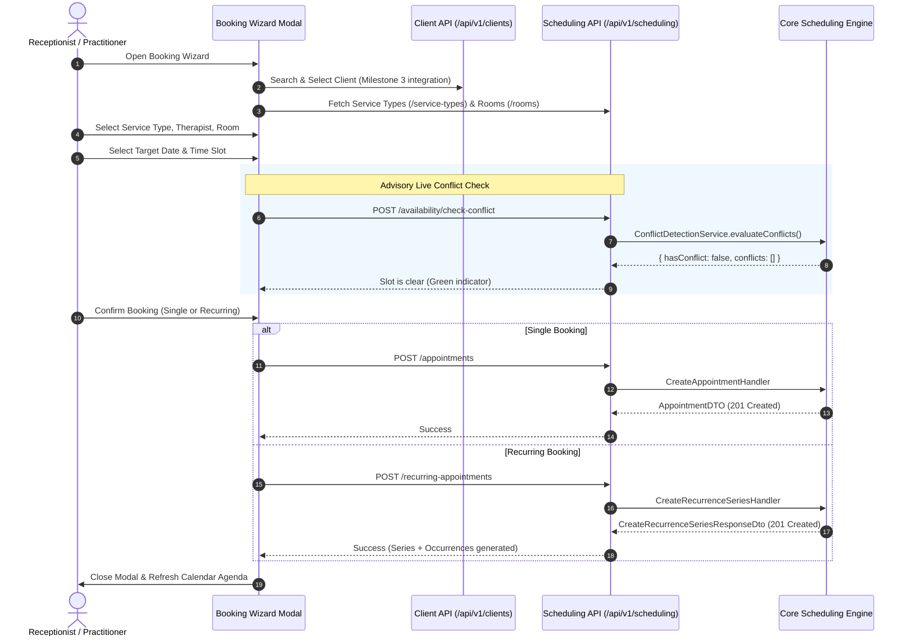
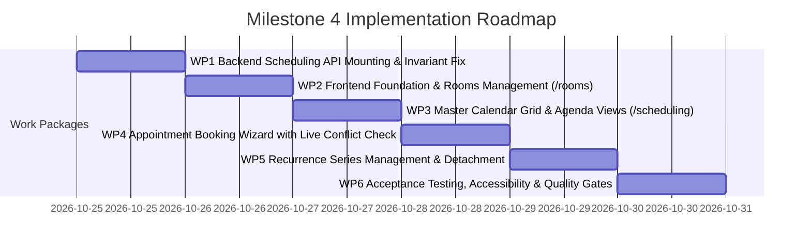

# Milestone 4: Scheduling Contract Freeze and Implementation Blueprint

**Status:** Approved & Frozen  
**Author:** Senior Software Architect & Full-Stack Lead  
**Scope:** Milestone 4 Scheduling & Appointments Frontend and Backend Systems  
**Date:** October 2026  
**Authoritative References:**

- [`docs/audits/milestone-4-scheduling-audit.md`](file:///c:/Projects/kinergy-platform/docs/audits/milestone-4-scheduling-audit.md)
- [`docs/audits/frontend-productization/frontend-productization-roadmap.md`](file:///c:/Projects/kinergy-platform/docs/audits/frontend-productization/frontend-productization-roadmap.md)
- [`docs/adr/ADR-time-timezone-strategy.md`](file:///c:/Projects/kinergy-platform/docs/adr/ADR-time-timezone-strategy.md)
- [`docs/adr/0043-recurring-appointment-scheduling-strategy.md`](file:///c:/Projects/kinergy-platform/docs/adr/0043-recurring-appointment-scheduling-strategy.md)
- [`docs/adr/0044-schedulable-resource-and-room-scheduling-architecture.md`](file:///c:/Projects/kinergy-platform/docs/adr/0044-schedulable-resource-and-room-scheduling-architecture.md)

---

## 1. Executive Summary & Architectural Scope

This document establishes the **contract freeze and deterministic implementation blueprint** for **Milestone 4: Scheduling & Appointments Frontend Experience**.

### 1.1 Scope Boundaries

Milestone 4 delivers the complete operational scheduling capability for receptionists, facility managers, and practitioners:

1. **Master Calendar Grid (`/scheduling`)**: Interactive Day and Week resource scheduler supporting multi-therapist and multi-room calendar views.
2. **Appointment Booking Wizard**: Multi-step client, service type, therapist, room, and time slot selection with advisory live conflict evaluation and atomic backend booking.
3. **Recurring Series Management**: Creation of recurring appointment series, horizon materialization, occurrence skipping, single-slot detachment, and cutoff-and-fork modifications.
4. **Rooms & Resource Management (`/scheduling/rooms`)**: Spatial resource directory, capacity tracking, operational status controls (`AVAILABLE` vs. `UNAVAILABLE`), and maintenance window scheduling.

### 1.2 Readiness Verdict

- **Frontend Ready (100% Backed):** Rooms & Schedulable Resources (`/scheduling/rooms`) is fully backed by the registered, tested `RoomsController` in `apps/api/src/scheduling/controllers/rooms.controller.ts`.
- **Backend Blocked:** The Master Calendar Grid (`/scheduling`) and Booking Wizard are blocked because single appointment CRUD, clinical lifecycle status transitions, live conflict detection, and calendar agenda projections currently have **zero HTTP endpoints registered in `apps/api`**.
- **Execution Strategy:** Implementation must be phased: **Work Package 1** unblocks the backend API by mounting the missing controllers (`AppointmentsController`, `AvailabilityController`, `CalendarController`) and providing valid therapist schedule defaults; subsequent work packages build out the frontend modules on verified endpoints.

---

## 2. Capability Classification Matrix

| Capability                         | Domain/Core Source                                                                                          | Persistence / DB                | HTTP API Status                                            | Classification            | Implementation Action                                      |
| :--------------------------------- | :---------------------------------------------------------------------------------------------------------- | :------------------------------ | :--------------------------------------------------------- | :------------------------ | :--------------------------------------------------------- |
| **Room Directory & Details**       | `Room` aggregate, `ListRoomsHandler`                                                                        | `rooms` table                   | `GET /api/v1/scheduling/rooms` (Mounted)                   | **Ready for Frontend**    | Connect directly to existing API                           |
| **Room CRUD & Versioning**         | `CreateRoomHandler`, `EditRoomHandler`                                                                      | `rooms` table                   | `POST`, `PATCH /api/v1/scheduling/rooms` (Mounted)         | **Ready for Frontend**    | Connect directly to existing API                           |
| **Room Status Machine**            | `ActivateRoomHandler`, `DeactivateRoomHandler`                                                              | `rooms` table                   | `POST .../:id/{activate,deactivate}` (Mounted)             | **Ready for Frontend**    | Connect directly to existing API                           |
| **Room Maintenance**               | `ScheduleMaintenanceHandler`, `CancelMaintenanceHandler`                                                    | `maintenance_windows` table     | `POST`, `DELETE .../:id/maintenance` (Mounted)             | **Ready for Frontend**    | Connect directly to existing API                           |
| **Room Vacancy Queries**           | `CheckRoomAvailabilityHandler`                                                                              | `rooms` + `appointments`        | `GET /api/v1/scheduling/rooms/availability` (Mounted)      | **Ready for Frontend**    | Connect directly to existing API                           |
| **Recurring Series CRUD**          | `RecurrenceSeries`, `CreateRecurrenceSeriesHandler`                                                         | `rec_series` table              | `POST /api/v1/scheduling/recurring-appointments` (Mounted) | **Required Backend Fix**  | Unblock therapist schedule stub in `SchedulingModule`      |
| **Occurrence Exceptions**          | `SkipRecurrenceOccurrenceHandler`, `EditSingleOccurrenceHandler`                                            | `rec_exceptions` table          | `POST .../:id/skip`, `PATCH .../occurrences/:id` (Mounted) | **Ready for Frontend**    | Connect directly to existing API                           |
| **Cutoff-and-Fork Series**         | `EditFutureOccurrencesHandler`                                                                              | `rec_series` table              | `POST .../:id/edit-future` (Mounted)                       | **Ready for Frontend**    | Connect directly to existing API                           |
| **List Appointments (Range)**      | `FindAppointmentsByRangeHandler`                                                                            | `appointments` table            | **UNMOUNTED**                                              | **Required Backend Work** | Mount `AppointmentsController.listAppointments`            |
| **Get Appointment Details**        | `GetAppointmentByIdHandler`                                                                                 | `appointments` table            | **UNMOUNTED**                                              | **Required Backend Work** | Mount `AppointmentsController.getAppointment`              |
| **Create Appointment**             | `CreateAppointmentHandler`                                                                                  | `appointments` table            | **UNMOUNTED**                                              | **Required Backend Work** | Mount `AppointmentsController.createAppointment`           |
| **Reschedule Appointment**         | `RescheduleAppointmentHandler`                                                                              | `appointments` table            | **UNMOUNTED**                                              | **Required Backend Work** | Mount `AppointmentsController.rescheduleAppointment`       |
| **Cancel Appointment**             | `CancelAppointmentHandler`                                                                                  | `appointments` table            | **UNMOUNTED**                                              | **Required Backend Work** | Mount `AppointmentsController.cancelAppointment`           |
| **Appointment Lifecycle**          | `ConfirmAppointmentHandler`, `CheckInAppointmentHandler`, `CompleteAppointmentHandler`, `MarkNoShowHandler` | `appointments` table            | **UNMOUNTED**                                              | **Required Backend Work** | Mount `AppointmentsController` lifecycle actions           |
| **Add Appointment Note**           | `AddAppointmentNoteHandler`                                                                                 | `appointment_notes` table       | **UNMOUNTED**                                              | **Required Backend Work** | Mount `AppointmentsController.addNote`                     |
| **Live Conflict Check**            | `CheckConflictHandler`, `ConflictDetectionService`                                                          | Cross-aggregate evaluation      | **UNMOUNTED**                                              | **Required Backend Work** | Mount `AvailabilityController.checkConflict`               |
| **Available Slots Search**         | `FindAvailableSlotsHandler`, `SlotFinderEngine`                                                             | Cross-aggregate evaluation      | **UNMOUNTED**                                              | **Required Backend Work** | Mount `AvailabilityController.findSlots`                   |
| **Calendar Agenda Queries**        | `GetDailyAgendaHandler`, `GetWeeklyAgendaHandler`                                                           | Projections across appointments | **UNMOUNTED**                                              | **Required Backend Work** | Mount `CalendarController.getAgenda`                       |
| **Bookable Service Types**         | `AppointmentTypeEnum`, `DefaultAppointmentDurationPolicy`                                                   | Hardcoded VO in core            | **UNMOUNTED**                                              | **Required Backend Work** | Expose `GET /api/v1/scheduling/service-types`              |
| **Therapist Schedule Persistence** | `TherapistSchedule` aggregate                                                                               | In-memory stub (`null`)         | **STUBBED**                                                | **Required Backend Work** | Provide default shift schedule (08:00-18:00) in repository |
| **Client Search & Ingress**        | Milestone 3 Client Module                                                                                   | `clients` table                 | `GET /api/v1/clients` (Mounted)                            | **Ready for Frontend**    | Reuse `useClientQueries` hook from Milestone 3             |

---

## 3. Exact API Contracts and Source References

### 3.1 Rooms & Schedulable Resources (Mounted: `apps/api/src/scheduling/controllers/rooms.controller.ts`)

- **List Rooms**: `GET /api/v1/scheduling/rooms`
  - Query: `status?: 'AVAILABLE' | 'UNAVAILABLE'`, `features?: string[]`, `minCapacity?: number`
  - Response: `RoomResponseDto[]`
  - Roles: `ADMIN`, `SUPER_ADMIN`, `RECEPTIONIST`, `THERAPIST` | Permission: `settings.read`
- **Get Room**: `GET /api/v1/scheduling/rooms/:id`
  - Response: `RoomResponseDto` (`id`, `name`, `capacity`, `status`, `features`, `maintenanceWindows`, `version`, `createdAt`, `updatedAt`)
  - Roles: `ADMIN`, `SUPER_ADMIN`, `RECEPTIONIST`, `THERAPIST` | Permission: `settings.read`
- **Create Room**: `POST /api/v1/scheduling/rooms`
  - Body: `{ name: string, capacity: number, features?: string[] }`
  - Response: `RoomResponseDto` (201 Created)
  - Roles: `ADMIN`, `SUPER_ADMIN` | Permission: `settings.write`
- **Edit Room**: `PATCH /api/v1/scheduling/rooms/:id`
  - Body: `{ name?: string, capacity?: number, features?: string[], expectedVersion: number }`
  - Response: `RoomResponseDto` (409 on version mismatch)
  - Roles: `ADMIN`, `SUPER_ADMIN` | Permission: `settings.write`
- **Activate Room**: `POST /api/v1/scheduling/rooms/:id/activate`
  - Body: `{ expectedVersion: number }`
  - Response: `RoomResponseDto`
  - Roles: `ADMIN`, `SUPER_ADMIN` | Permission: `settings.write`
- **Deactivate Room**: `POST /api/v1/scheduling/rooms/:id/deactivate`
  - Body: `{ reason: string, expectedVersion: number }`
  - Response: `RoomResponseDto`
  - Roles: `ADMIN`, `SUPER_ADMIN` | Permission: `settings.write`
- **Schedule Maintenance**: `POST /api/v1/scheduling/rooms/:id/maintenance`
  - Body: `{ startTime: string (ISO), endTime: string (ISO), reason: string, expectedVersion: number }`
  - Response: `RoomResponseDto` (201 Created)
  - Roles: `ADMIN`, `SUPER_ADMIN` | Permission: `settings.write`
- **Cancel Maintenance**: `DELETE /api/v1/scheduling/rooms/:id/maintenance/:maintenanceId`
  - Response: `RoomResponseDto`
  - Roles: `ADMIN`, `SUPER_ADMIN` | Permission: `settings.write`
- **Check Room Vacancy**: `GET /api/v1/scheduling/rooms/availability`
  - Query: `startTime: string (ISO)`, `endTime: string (ISO)`, `roomId?: string`, `requiredFeatures?: string[]`, `requiredCapacity?: number`
  - Response: `{ isAvailable: boolean, reason?: string, availableRooms?: RoomResponseDto[] }`
  - Roles: `ADMIN`, `SUPER_ADMIN`, `RECEPTIONIST`, `THERAPIST` | Permission: `appointments.read`

---

### 3.2 Recurring Appointments (Mounted: `apps/api/src/scheduling/controllers/recurring-appointments.controller.ts`)

- **Create Series**: `POST /api/v1/scheduling/recurring-appointments`
  - Body: `{ clientId: string, therapistId: string, roomId: string, serviceType: string, frequency: 'DAILY'|'WEEKLY'|'BIWEEKLY'|'MONTHLY', startDate: string (ISO), endDate?: string (ISO), maxOccurrences?: number, localStartTime: string ("HH:mm"), durationMinutes: number, timezone: string ("America/New_York"), horizonDays?: number }`
  - Response: `CreateRecurrenceSeriesResponseDto` (`series: RecurrenceSeriesDTO`, `initialGeneration: { generatedCount: number, conflictingOccurrences: ... }`)
  - Roles: `ADMIN`, `SUPER_ADMIN`, `RECEPTIONIST`, `THERAPIST` | Permission: `appointments.create`
- **Skip Occurrence**: `POST /api/v1/scheduling/recurring-appointments/:seriesId/skip`
  - Body: `{ occurrenceIndex: number, reason?: string }`
  - Response: `SkipOccurrenceResponseDto` (`seriesId: string`, `occurrenceIndex: number`, `status: 'SKIPPED'`)
  - Roles: `ADMIN`, `SUPER_ADMIN`, `RECEPTIONIST`, `THERAPIST` | Permission: `appointments.update`
- **Edit Single Occurrence (Detach)**: `PATCH /api/v1/scheduling/recurring-appointments/occurrences/:appointmentId`
  - Body: `{ newStartTime?: string (ISO), newTherapistId?: string, newRoomId?: string, rescheduleReason?: string }`
  - Response: `AppointmentDTO` (Marks `isDetachedFromSeries = true`)
  - Roles: `ADMIN`, `SUPER_ADMIN`, `RECEPTIONIST`, `THERAPIST` | Permission: `appointments.update`
- **Edit Future Occurrences (Cutoff-and-Fork)**: `POST /api/v1/scheduling/recurring-appointments/:seriesId/edit-future`
  - Body: `{ cutoffDate: string (ISO), fromOccurrenceIndex: number, newFrequency?: string, newLocalStartTime?: string, newDurationMinutes?: number, newTherapistId?: string, newRoomId?: string, newEndDate?: string, newMaxOccurrences?: number }`
  - Response: `EditFutureOccurrencesResponseDto` (`oldSeriesId: string`, `newSeries: RecurrenceSeriesDTO`, `initialGeneration: ...`)
  - Roles: `ADMIN`, `SUPER_ADMIN`, `RECEPTIONIST`, `THERAPIST` | Permission: `appointments.update`
- **Cancel Series**: `POST /api/v1/scheduling/recurring-appointments/:seriesId/cancel`
  - Body: `{ reason?: string }`
  - Response: `CancelRecurrenceSeriesResponseDto` (`seriesId: string`, `cancelledCount: number`)
  - Roles: `ADMIN`, `SUPER_ADMIN`, `RECEPTIONIST`, `THERAPIST` | Permission: `appointments.delete`

---

### 3.3 Appointments Controller (To Be Mounted in Work Package 1)

Target File: `apps/api/src/scheduling/controllers/appointments.controller.ts`

- **List Appointments**: `GET /api/v1/scheduling/appointments`
  - Query: `startDate: string (ISO)`, `endDate: string (ISO)`, `therapistId?: string`, `roomId?: string`, `clientId?: string`, `status?: string`
  - Handler: `FindAppointmentsByRangeHandler`
  - Response: `AppointmentDTO[]`
  - Roles: `ADMIN`, `SUPER_ADMIN`, `RECEPTIONIST`, `THERAPIST` | Permission: `appointments.read`
- **Get Appointment**: `GET /api/v1/scheduling/appointments/:id`
  - Handler: `GetAppointmentByIdHandler`
  - Response: `AppointmentDTO`
  - Roles: `ADMIN`, `SUPER_ADMIN`, `RECEPTIONIST`, `THERAPIST` | Permission: `appointments.read`
- **Create Appointment**: `POST /api/v1/scheduling/appointments`
  - Body: `{ clientId: string, therapistId: string, roomId: string, type: string, startTime: string (ISO), endTime: string (ISO), notes?: string }`
  - Handler: `CreateAppointmentHandler`
  - Response: `AppointmentDTO` (201 Created; 409 Conflict if slot is taken)
  - Roles: `ADMIN`, `SUPER_ADMIN`, `RECEPTIONIST`, `THERAPIST` | Permission: `appointments.create`
- **Reschedule Appointment**: `PATCH /api/v1/scheduling/appointments/:id/reschedule`
  - Body: `{ newStartTime: string (ISO), newEndTime: string (ISO), reason?: string }`
  - Handler: `RescheduleAppointmentHandler`
  - Response: `AppointmentDTO`
  - Roles: `ADMIN`, `SUPER_ADMIN`, `RECEPTIONIST`, `THERAPIST` | Permission: `appointments.update`
- **Cancel Appointment**: `POST /api/v1/scheduling/appointments/:id/cancel`
  - Body: `{ reason: string }` (Mandatory non-empty string)
  - Handler: `CancelAppointmentHandler`
  - Response: `AppointmentDTO`
  - Roles: `ADMIN`, `SUPER_ADMIN`, `RECEPTIONIST`, `THERAPIST` | Permission: `appointments.delete`
- **Lifecycle Action (Confirm)**: `POST /api/v1/scheduling/appointments/:id/confirm`
  - Handler: `ConfirmAppointmentHandler`
  - Response: `AppointmentDTO`
  - Roles: `ADMIN`, `SUPER_ADMIN`, `RECEPTIONIST`, `THERAPIST` | Permission: `appointments.update`
- **Lifecycle Action (Check-In)**: `POST /api/v1/scheduling/appointments/:id/check-in`
  - Handler: `CheckInAppointmentHandler`
  - Response: `AppointmentDTO`
  - Roles: `ADMIN`, `SUPER_ADMIN`, `RECEPTIONIST`, `THERAPIST` | Permission: `appointments.update`
- **Lifecycle Action (Complete)**: `POST /api/v1/scheduling/appointments/:id/complete`
  - Handler: `CompleteAppointmentHandler`
  - Response: `AppointmentDTO`
  - Roles: `ADMIN`, `SUPER_ADMIN`, `RECEPTIONIST`, `THERAPIST` | Permission: `appointments.update`
- **Lifecycle Action (No-Show)**: `POST /api/v1/scheduling/appointments/:id/no-show`
  - Body: `{ reason?: string }`
  - Handler: `MarkNoShowHandler`
  - Response: `AppointmentDTO`
  - Roles: `ADMIN`, `SUPER_ADMIN`, `RECEPTIONIST`, `THERAPIST` | Permission: `appointments.update`
- **Add Note**: `POST /api/v1/scheduling/appointments/:id/notes`
  - Body: `{ content: string }`
  - Handler: `AddAppointmentNoteHandler`
  - Response: `AppointmentDTO`
  - Roles: `ADMIN`, `SUPER_ADMIN`, `RECEPTIONIST`, `THERAPIST` | Permission: `appointments.update`

---

### 3.4 Availability & Calendar Controllers (To Be Mounted in Work Package 1)

Target Files:

- `apps/api/src/scheduling/controllers/availability.controller.ts`
- `apps/api/src/scheduling/controllers/calendar.controller.ts`

- **Live Conflict Validation**: `POST /api/v1/scheduling/availability/check-conflict`
  - Body: `{ therapistId: string, roomId: string, clientId: string, startTime: string (ISO), endTime: string (ISO), appointmentType?: string, excludeAppointmentId?: string }`
  - Handler: `CheckConflictHandler`
  - Response: `ConflictCheckResponseDTO` (`{ hasConflict: boolean, conflicts: Array<{ category: string, conflictingEntityId: string, reason: string }> }`)
  - Roles: `ADMIN`, `SUPER_ADMIN`, `RECEPTIONIST`, `THERAPIST` | Permission: `appointments.read`
- **Find Available Slots**: `GET /api/v1/scheduling/availability/slots`
  - Query: `date: string (YYYY-MM-DD)`, `serviceType: string`, `therapistId?: string`, `roomId?: string`
  - Handler: `FindAvailableSlotsHandler`
  - Response: `SlotResponseDTO[]` (`{ startTime: string, endTime: string, therapistId: string, roomId: string, available: boolean }`)
  - Roles: `ADMIN`, `SUPER_ADMIN`, `RECEPTIONIST`, `THERAPIST` | Permission: `appointments.read`
- **Calendar Agenda Projections**: `GET /api/v1/scheduling/calendar/agenda`
  - Query: `view: 'day' | 'week'`, `date: string (YYYY-MM-DD)`, `therapistId?: string`, `roomId?: string`
  - Handlers: `GetDailyAgendaHandler`, `GetWeeklyAgendaHandler`
  - Response:
    - If `view === 'day'`: `DailyAgendaDTO` (`{ date, totalAppointments, summaryByStatus, slots, appointmentsByTherapist, appointmentsByRoom }`)
    - If `view === 'week'`: `WeeklyAgendaDTO` (`{ startDate, endDate, totalAppointments, dailyAgendas: DailyAgendaDTO[] }`)
  - Roles: `ADMIN`, `SUPER_ADMIN`, `RECEPTIONIST`, `THERAPIST` | Permission: `appointments.read`
- **Bookable Service Types**: `GET /api/v1/scheduling/service-types`
  - Response: `Array<{ type: string, label: string, standardDurationMinutes: number, minDurationMinutes: number, maxDurationMinutes: number }>`
  - Backed by: `AppointmentTypeEnum` & `DefaultAppointmentDurationPolicy`
  - Roles: All authenticated staff | Permission: `appointments.read`

---

## 4. Canonical Temporal Representation & Timezone Standard

### 4.1 Authoritative Standard (ADR-005 Compliance)

- **Facility Timezone**: The platform operating timezone is **`America/New_York`**.
- **Persisted Instants**: All appointment timestamps in PostgreSQL (`appointments.start_time`, `appointments.end_time`, `rec_series.start_date`, `rec_series.end_date`) are stored in **UTC** as ISO 8601 strings ending in `Z` (e.g. `2026-10-24T14:00:00.000Z`).
- **Recurrence Time Parameters**:
  - `localStartTime`: 24-hour time format `"HH:mm"` (e.g. `"09:30"`).
  - `durationMinutes`: positive integer (e.g. `60`).
  - `timezone`: IANA string (e.g. `"America/New_York"`).
- **Daylight Saving Time Policy**:
  - Local appointments preserve wall-clock time across DST transitions.
  - An occurrence at 09:30 AM in `America/New_York` maps to `14:30:00Z` in EST (UTC-5) and `13:30:00Z` in EDT (UTC-4).
  - The frontend must never calculate recurrence occurrences by naive millisecond arithmetic. The backend `RecurrenceCalculationEngine` remains the single source of truth for occurrence slot calculation.

### 4.2 Frontend Date Conventions

- **Date Inputs**: Frontend form inputs collect local date strings (`"YYYY-MM-DD"`) and local time strings (`"HH:mm"`).
- **Serialization**: The frontend converts local date/time into a facility-anchored UTC ISO string prior to API submission.
- **Display Formatting**: All grid cells, timestamps, and tooltips format instants using `Intl.DateTimeFormat` configured with `{ timeZone: 'America/New_York' }` so that users in any browser timezone see authoritative clinic time.

---

## 5. Calendar Query Model & URL-Driven State Standard

In compliance with the **Frontend Implementation Standard** and `useTableUrlState`:

### 5.1 URL Parameters (`/scheduling`)

The calendar grid state is completely synchronized with the browser URL:

| Query Param   | Type                  | Default                            | Description                                |
| :------------ | :-------------------- | :--------------------------------- | :----------------------------------------- |
| `view`        | `'day' \| 'week'`     | `'week'`                           | Active calendar view mode                  |
| `date`        | `string (YYYY-MM-DD)` | Current date in `America/New_York` | Reference date anchor                      |
| `therapistId` | `string`              | `undefined` (All)                  | Filter grid to a specific therapist column |
| `roomId`      | `string`              | `undefined` (All)                  | Filter grid to a specific room column      |
| `status`      | `string`              | `undefined` (All non-cancelled)    | Comma-separated status filters             |

### 5.2 TanStack Query Cache Keys

```ts
export const schedulingQueryKeys = {
  all: ['scheduling'] as const,
  agenda: (params: { view: string; date: string; therapistId?: string; roomId?: string }) =>
    ['scheduling', 'agenda', params] as const,
  appointments: (filters: {
    startDate: string;
    endDate: string;
    therapistId?: string;
    roomId?: string;
  }) => ['scheduling', 'appointments', filters] as const,
  appointmentDetail: (id: string) => ['scheduling', 'appointments', 'detail', id] as const,
  rooms: (filters?: { status?: string; features?: string[] }) =>
    ['scheduling', 'rooms', filters] as const,
  roomDetail: (id: string) => ['scheduling', 'rooms', 'detail', id] as const,
  roomAvailability: (params: { startTime: string; endTime: string; roomId?: string }) =>
    ['scheduling', 'rooms', 'availability', params] as const,
  serviceTypes: () => ['scheduling', 'service-types'] as const,
  recurringSeries: (id: string) => ['scheduling', 'recurring-series', id] as const,
  liveConflictCheck: (params: CheckConflictParams) =>
    ['scheduling', 'conflict-check', params] as const,
};
```

---

## 6. Appointment Booking Flow & Dependency Order



### 6.1 Two-Tier Conflict Invariant Enforcement

1. **Advisory Frontend Check**: When a time slot is clicked or modified in the wizard, a debounced query is sent to `POST /api/v1/scheduling/availability/check-conflict`. If conflicts exist (e.g. therapist double-booked, room maintenance window), clear warnings are displayed with the specific conflicting entity.
2. **Authoritative Backend Lock**: During `POST /appointments` or `POST /recurring-appointments`, the application handler re-executes `ConflictDetectionService.detectConflicts()`. If a concurrent user booked the same resource, the API rejects the request with `409 Conflict`, which the wizard catches to display a recovery prompt.

---

## 7. Recurrence Semantics & Supported UI Operations

The frontend UI will strictly expose **only** the recurrence operations supported by `RecurrenceSeries` and `RecurringAppointmentsController`:

| UI Action                   | Trigger Point                | API Endpoint                                                                 | Domain Semantics                                                                                                    |
| :-------------------------- | :--------------------------- | :--------------------------------------------------------------------------- | :------------------------------------------------------------------------------------------------------------------ |
| **Create Series**           | Booking Wizard               | `POST /api/v1/scheduling/recurring-appointments`                             | Creates `RecurrenceSeries` aggregate; generates rolling occurrences (up to 90 days).                                |
| **Skip Occurrence**         | Appointment Context Menu     | `POST /api/v1/scheduling/recurring-appointments/:seriesId/skip`              | Appends `SKIPPED` exception to series; cancels materialized appointment slot.                                       |
| **Reschedule Single Slot**  | Drag-and-drop or Edit Dialog | `PATCH /api/v1/scheduling/recurring-appointments/occurrences/:appointmentId` | Marks appointment `isDetachedFromSeries = true`; appends `MODIFIED` exception to parent series.                     |
| **Edit Future Occurrences** | Series Detail Dialog         | `POST /api/v1/scheduling/recurring-appointments/:seriesId/edit-future`       | Truncates old series at `cutoffDate`; cancels unmaterialized future appointments; forks new child series aggregate. |
| **Cancel Series**           | Series Management Drawer     | `POST /api/v1/scheduling/recurring-appointments/:seriesId/cancel`            | Marks series `CANCELLED`; cancels all future scheduled occurrences; cleanly preserves past completed appointments.  |

- **UI Constraints**: The UI will not expose arbitrary recurrence rules (such as "every 3rd Tuesday"). It will strictly provide: `DAILY`, `WEEKLY`, `BIWEEKLY`, `MONTHLY`, with an optional end date or occurrence count.

---

## 8. Room Management Capabilities and Limitations

### 8.1 Supported Capabilities (`/scheduling/rooms`)

- **Directory Table**: Paginated, filterable table of rooms displaying name, capacity, equipment feature tags (`["PILATES_REFORMER", "MASSAGE_TABLE"]`), and current operational status.
- **Room Creation & Editing**: Modal form with optimistic version checking (`expectedVersion`).
- **Operational Status Toggling**:
  - `Activate`: Transitions room to `AVAILABLE`.
  - `Deactivate`: Modal prompting for a **mandatory operational reason** (e.g. "Water leak repair") and transitioning room to `UNAVAILABLE`.
- **Maintenance Windows**:
  - Schedule temporal maintenance blocks `[start, end)` with reason.
  - Delete scheduled maintenance windows.
  - Visual indicator on room card showing active maintenance.

### 8.2 Architectural Limitations

- Rooms do not support physical sub-partitioning (rooms cannot be dynamically split into half-rooms).
- Deactivating a room does not automatically cancel existing appointments; it prevents new reservations. Existing appointments in an unavailable room are flagged with a visual warning badge on the Master Calendar Grid.

---

## 9. Phased Implementation Work Packages



### Work Package 1 — Backend Scheduling API Mounting & Invariant Fix

- **Goal:** Unblock the HTTP layer by mounting single appointment operations, availability queries, and agenda projections in `apps/api`.
- **Tasks:**
  1. Create `AppointmentsController` with list, get, create, reschedule, cancel, lifecycle actions, and notes.
  2. Create `AvailabilityController` with `check-conflict` and `slots`.
  3. Create `CalendarController` with `agenda` projection queries.
  4. Create `ServiceTypesController` or static catalog endpoint exposing bookable appointment types.
  5. Provide default shift schedule (08:00–18:00) in `TherapistScheduleRepository` stub so conflict evaluation succeeds.
  6. Register controllers in `SchedulingModule`.
  7. Add controller unit tests and verify `pnpm validate` passes.

### Work Package 2 — Frontend Foundation & Rooms Management

- **Goal:** Establish `apps/web/src/modules/scheduling` and deliver `/scheduling/rooms`.
- **Tasks:**
  1. Create module directory structure (`api`, `hooks`, `components`, `routes`, `schemas`).
  2. Register `/scheduling/rooms` in `app-router.tsx` and `navigation.config.ts`.
  3. Implement `rooms-api.ts` and TanStack query hooks (`useRoomQueries`, `useRoomMutations`).
  4. Implement `RoomsListPage` with capacity indicators, feature badges, and status toggles.
  5. Implement `CreateRoomDialog`, `EditRoomDialog`, `DeactivateRoomDialog`, and `MaintenanceWindowDialog`.
  6. Write RTL component tests and `jest-axe` accessibility tests.

### Work Package 3 — Master Calendar Grid & Agenda Views

- **Goal:** Deliver interactive resource calendar grid at `/scheduling`.
- **Tasks:**
  1. Register `/scheduling` route with `appointments.read` guard.
  2. Implement native CSS Grid calendar component supporting Day and Week views.
  3. Implement URL search param synchronization (`useTableUrlState`).
  4. Display appointment chips with status colors, client name, service type, and conflict badges.
  5. Implement Appointment Details Drawer with one-click lifecycle actions (`Confirm`, `Check In`, `Start`, `Complete`, `Cancel`, `No-Show`).

### Work Package 4 — Appointment Booking Wizard

- **Goal:** Deliver multi-step modal for booking single appointments with live conflict checking.
- **Tasks:**
  1. Step 1: Client selection (integrated with Milestone 3 `useClientQueries`).
  2. Step 2: Service type selection with automatic duration filling.
  3. Step 3: Therapist and Room selection.
  4. Step 4: Time slot picker with debounced call to `/availability/check-conflict`.
  5. Submission to `POST /api/v1/scheduling/appointments` with error handling (409 Conflict).

### Work Package 5 — Recurring Series Management & Detachment

- **Goal:** Complete recurrence workflows.
- **Tasks:**
  1. Add recurrence configuration toggle in Booking Wizard (frequency, end date, max occurrences).
  2. Implement `RecurringSeriesDetailPage` showing recurrence pattern and occurrence ledger.
  3. Implement Skip Occurrence action dialog.
  4. Implement Single Occurrence Detach & Reschedule modal.
  5. Implement Cutoff-and-Fork modal (`edit-future`).

### Work Package 6 — Acceptance Testing, Accessibility & Quality Gates

- **Goal:** Certify Milestone 4 completion.
- **Tasks:**
  1. End-to-end integration tests for calendar navigation and appointment lifecycle.
  2. WCAG 2.1 AA keyboard accessibility audit (`role="grid"`, arrow key cell navigation).
  3. Run full verification suite: `pnpm validate` (Prettier, ESLint, TypeScript, Jest, Nx build).

---

## 10. Required Quality Gates

Every implementation work package must pass the following quality gates before merging:

1. **Code Formatting:** `pnpm format:check` passes with zero warnings.
2. **Type Safety:** `pnpm typecheck` (`tsc --noEmit -p tsconfig.base.json`) completes with 0 errors.
3. **Linting:** `nx run-many -t lint` completes with zero ESLint errors.
4. **Unit & Integration Tests:** 100% pass across all affected projects (`core`, `api`, `web`).
5. **Accessibility (Frontend):** Zero WCAG 2.1 AA violations on all new views verified with `jest-axe`.
6. **Workspace Build:** `nx run-many -t build` completes successfully.
